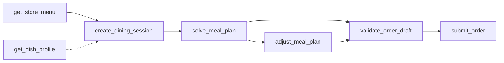

# 深圳烧烤店 AI 智能点餐系统 — Remote MCP 工具接入指南

> **协议版本**：Model Context Protocol (MCP) v1.0 / Remote HTTP  
> **服务基础路径**：`http(s)://<your-domain-or-ip>:8080/mcp/v1`  
> **适用端点**：Claude Desktop, Cursor, Dify, FastGPT, LangChain, 微信/企微智能体  
> **文档维护**：研发团队 (WI-065)

---

## 一、协议概述与设计哲学

本服务基于 Anthropic 主导的 **Model Context Protocol (MCP)** 规范，为各类大模型智能体（LLM Agents）提供接入真实烧烤店点餐全流程的标准化工具集。

### 核心设计守则（Hard Invariants）：
1. **真实数据源原则（No Hallucination）**：所有菜品单价、库存、在售状态均源自门店云端数据库，禁止大模型臆造菜品或捏造单价。
2. **资金安全原则（Integer Cents）**：所有金额字段严格使用**整数分**（例如 150 元表示为 `15000`），彻底消除浮点数精度漂移。
3. **试点门店与统一字段**：MCP 工具入参已统一使用 **`shop_id`**（试点门店固定为 `3`；服务端保留对旧 `store_id` 的兼容回退）。非 3 号门店调用将直接返回 HTTP 403。
4. **确定性规划引擎**：大模型仅负责意图理解与用户友好解释，菜品组合与约束规划由原生 Java 规划求解器执行。
5. **双重校价与强幂等落单**：正式提交订单前强制执行二次校价校库，落单需携带 `idempotency_key` 保证云端单一权威。

---

## 二、端点通信规范

服务端提供双路由适配，客户端可按需采用任意一种方式：

### 1. 工具清单发现（List Tools）
- **请求方式**：`GET /mcp/v1/tools`
- **说明**：返回所有已注册工具的名称、描述与符合 JSON Schema 规范的 `inputSchema`。

### 2. 工具执行（Call Tool）
- **方式 A（RESTful 路径路由）**：
  - `POST /mcp/v1/tools/{toolName}`
  - 请求体：`{ "arguments": { ... } }`
- **方式 B（统一分发路由 / JSON-RPC 风格）**：
  - `POST /mcp/v1/tools/execute`
  - 请求体：`{ "tool": "{toolName}", "arguments": { ... } }`

### 3. 响应报文格式
响应结构兼顾标准 MCP 规范（供大模型直接阅读的文本）与业务结构化数据（供工作流解析）：
```json
{
  "code": 200,
  "msg": "success",
  "isError": false,
  "content": [
    {
      "type": "text",
      "text": "{\n  \"status\": \"SUCCESS\",\n  ...\n}"
    }
  ],
  "result": {
    "status": "SUCCESS",
    ...
  }
}
```

### 4. 大模型直调对话接口（Chat with LLM）
用于让外部客户端/前端直接发起自然语言问答，由后端根据**环境变量**自动桥接调用大模型并返回推理结果：
- **请求方式**：`POST /mcp/v1/chat`
- **请求体**：
  ```json
  {
    "shop_id": 3,
    "prompt": "我们 3 个人，预算 200，有 1 人不吃辣，推荐一下招牌烤串"
  }
  ```
- **配置探测**：`GET /mcp/v1/config`（返回当前读取的环境变量与脱敏后的 API Key）

### 5. 大模型环境变量配置字典

服务支持通过操作系统或容器环境变量无缝配置大模型，优先级高于配置文件：

| 环境变量名 | 说明 | 缺省回退值 | 示例 |
| :--- | :--- | :--- | :--- |
| `LLM_API_KEY` | 大模型 API Key（也兼容 `AI_API_KEY`、`ARK_API_KEY`） | `ai.api.key` | `sk-xxxxxxxxxxxxxxxx` |
| `LLM_API_URL` | 大模型接口完整 URL | `https://api.deepseek.com/v1/chat/completions` | `https://api.deepseek.com/v1/chat/completions` |
| `LLM_MODEL` | 模型名称或方舟 Endpoint ID | `deepseek-chat` | `deepseek-chat` / `ep-2024xxxx` / `qwen-plus` |
| `LLM_TEMPERATURE` | 采样温度 (0.0 ~ 1.0) | `0.7` | `0.7` |
| `LLM_MAX_TOKENS` | 单次最大输出 Token 数 | `2048` | `2048` |

---

## 三、7 大标准 MCP 工具契约详解



### 1. `get_store_menu`：获取门店菜单快照与防漂移版本
- **描述**：获取当前门店所有在售菜品的基础属性与扩展画像，并返回 SHA-256 数据版本 Hash（`menu_version`）。
- **参数 (`inputSchema`)**：
  - `shop_id` (integer, 必填, 试点门店固定为 3)：门店ID（兼容 `store_id`）。
- **返回核心字段**：`menu_version`、`shop_id`、`items`（菜品列表、单价分、月销量、图片、辣度、过敏原、是否可免辣等）。

### 2. `get_dish_profile`：查询单品画像详情
- **描述**：查询单个菜品的原料、健康画像、过敏原及后厨免辣加工能力。
- **参数 (`inputSchema`)**：
  - `dish_id` (integer, 必填)：菜品ID。
  - `shop_id` (integer, 必填, 试点门店固定为 3)：门店ID（兼容 `store_id`）。
- **返回核心字段**：`non_spicy_available`、`calories_kcal`、`verified_allergens`、`spice_options`。

### 3. `create_dining_session`：创建餐桌多人协同会话
- **描述**：登记就餐桌号、人数、总预算分、风味偏好与成员个性化诉求（餐桌 DNA）。
- **参数 (`inputSchema`)**：
  - `shop_id` (integer, 必填, 试点门店固定为 3)：门店ID（兼容 `store_id`）。
  - `table_number` (string, 可选, 默认 "A01")：桌号。
  - `party_size` (integer, 可选, 默认 2)：就餐人数（兼容 `diner_count`）。
  - `budget_fen` (integer, 必填)：总预算（单位：分，如 15000 代表 150元）。
  - `strategy` (string, 可选)：策略：`balanced` (均衡), `budget_first` (预算), `satiety_first` (吃饱), `high_protein` (高蛋白)。
  - `members` (array of objects, 可选)：成员数组：
    - `member_name` (string)：成员名称。
    - `spicy_level` (integer)：期望辣度（0:不吃辣, 1:微辣, 2:中辣）。
    - `allergens` (array of strings)：过敏原（如 `["seafood", "peanut"]`）。
    - `dietary_goal` (string)：饮食目标（`fitness`, `weight_loss`）。
- **返回核心字段**：`session_id`、`revision` (初始为 1)、`expires_at`。

### 4. `solve_meal_plan`：执行确定性规划配餐求解
- **描述**：调用两阶段词典序规划引擎，毫秒级计算严格满足硬约束的配餐组合，并生成面向顾客的解释说明。
- **参数 (`inputSchema`)**：
  - `session_id` (string, 必填)：会话ID。
  - `strategy` (string, 可选)：覆盖策略。
- **返回核心字段**：
  - `feasible` (boolean)：是否可行（若预算不足返回 `false`）。
  - `plan_id` (string)：方案ID。
  - `total_price_fen` (integer)：方案总金额（分）。
  - `line_items` (array)：推荐菜品明细、份数、分配归属（专属免辣或全桌共享）。
  - `explanation` (string)：确定性分配原因文案。
  - `conflict_details` (object)：若无可行解时，给出的对偶松弛建议及最小预算差额 `min_budget_fen`。

### 5. `adjust_meal_plan`：增量重新调餐
- **描述**：根据顾客的动态反馈（如“再加一份羊肉串”、“不要牛肉”、“再省20元”）执行重算。
- **参数 (`inputSchema`)**：
  - `plan_id` (string, 必填)：原方案ID。
  - `patch_text` (string, 必填)：调整自然语言描述或结构化补丁。
- **返回核心字段**：调整后的新方案 `adjusted_plan`。

### 6. `validate_order_draft`：提交前二次校价与校库
- **描述**：将选定方案转化为草稿，并与当前门店最新的在售单价和实时库存进行严格校验。
- **参数 (`inputSchema`)**：
  - `draft_id` (string, 必填)：草稿ID。
- **返回核心字段**：`validation_status`（`VALID` 或 `INVALID`）、`discrepancies`（变动明细）。

### 7. `submit_order`：用户明确确认正式落单
- **描述**：【高风险写操作】用户显式确认后，幂等创建正式订单进入云端核心交易流水与厨房 KDS。
- **参数 (`inputSchema`)**：
  - `draft_id` (string, 必填)：草稿ID。
  - `idempotency_key` (string, 必填)：客户端生成的唯一幂等键（UUID）。
  - `user_confirmed` (boolean, 必填)：必须为 `true`。
- **返回核心字段**：`status: "ORDER_CREATED"`、`order_no`（正式订单号）。

---

## 四、主流大模型与智能体平台接入配置

### 1. Dify / FastGPT 接入配置
在 Dify / FastGPT 的「自定义工具 / API 工具」中配置：

- **名称**：`bbq_smart_order`
- **Schema 模式**：选择 `OpenAPI / Swagger` 格式，直接导入后端的 OpenAPI 地址：
  ```
  http://<server-ip>:8080/v3/api-docs 或 docs/openapi.yaml
  ```
- **配置快捷调用**：
  - 工具路径：`http://<server-ip>:8080/mcp/v1/tools/solve_meal_plan`
  - Method：`POST`
  - Request Body：
    ```json
    {
      "arguments": {
        "session_id": "{{#session_id#}}"
      }
    }
    ```

### 2. Cursor / Claude Desktop (通过 HTTP SSE/Bridge 适配)
对于使用标准 Claude Desktop 的用户，在 `claude_desktop_config.json` 中配置：
```json
{
  "mcpServers": {
    "bbq-smart-dining": {
      "command": "npx",
      "args": [
        "-y",
        "mcp-remote-client",
        "http://localhost:8080/mcp/v1"
      ]
    }
  }
}
```

### 3. Python (LangChain / LlamaIndex / Agentic SDK) 接入示例
```python
import requests

BASE_URL = "http://localhost:8080/mcp/v1"

def call_mcp_tool(tool_name: str, arguments: dict):
    url = f"{BASE_URL}/tools/{tool_name}"
    resp = requests.post(url, json={"arguments": arguments})
    resp.raise_for_status()
    data = resp.json()
    if data.get("isError"):
        raise RuntimeError(f"Tool error: {data.get('content')}")
    return data.get("result")

# 1. 探索菜单
menu = call_mcp_tool("get_store_menu", {"shop_id": 3})
print(f"Store Menu Version: {menu['snapshot']['menu_version']}")

# 2. 创建会话 (6人 150元 2人不吃辣)
session = call_mcp_tool("create_dining_session", {
    "shop_id": 3,
    "party_size": 6,
    "budget_fen": 15000,
    "strategy": "balanced",
    "members": [
        {"member_name": "张免辣1", "spicy_level": 0},
        {"member_name": "李免辣2", "spicy_level": 0},
        {"member_name": "王吃辣", "spicy_level": 2}
    ]
})
session_id = session["session"]["session_id"]

# 3. 约束求解方案
plan_result = call_mcp_tool("solve_meal_plan", {"session_id": session_id})
print("配餐结果:", plan_result["plan"]["explanation"])
```

---

## 五、智能体系统提示词范式（System Prompt）

在配置 Dify / 微信客服 / AI 助手时，请使用以下 System Prompt 保证智能体行为严谨：

```markdown
你是“深圳东北大串烧烤店”官方 AI 点餐管家。你的职责是帮助进店顾客制定科学、好吃、不超预算的配餐方案。

【行为铁律】
1. 严禁自行编造任何菜品名称与单价，所有菜单信息必须通过调用 `get_store_menu` 或 `get_dish_profile` 获取。
2. 凡顾客提到“不吃辣”，必须严格为该成员分配经过核验的免辣保底荤食（non_spicy_available=1），绝不可把微辣烤串分配给免辣成员。
3. 方案必须经过工具 `solve_meal_plan` 计算，严格把总价控制在顾客声明的预算内（金额以分为单位，150元填15000）。
4. 在用户未明确表达“确认下单”之前，绝对禁止直接调用 `submit_order`；下单前必须先调用 `validate_order_draft` 进行二次校价。
5. 当预算过低无法配齐时，如实向顾客转达 `conflict_details` 中的差额与调整建议，态度友好诚恳。
```

---

## 六、常见错误码与排障速查

| 错误代码 / Reason | HTTP 状态码 | 产生原因 | 应对措施 |
| :--- | :--- | :--- | :--- |
| `TOOL_NOT_FOUND` | 404 | 调用的工具名不存在或拼写错误 | 检查 `GET /mcp/v1/tools`，核对工具名称 |
| `SHOP_NOT_SUPPORTED_FOR_MCP` | 403 | 请求门店非 3 号试点门店 | 核实并传入 `shop_id=3` |
| `REQUIRES_MENU_DATA` | 400 | 指定门店未配置在售菜单或菜品全下架 | 确认 `shop_id` 是否正确，先在后台录入菜品 |
| `BUDGET_INSUFFICIENT` | 200 (feasible=false) | 预算过低，无法满足每人至少一份保底荤食 | 读取 `min_budget_fen` 提示顾客追加预算或降低肉食比例 |
| `ORDER_CONFIRM_REQUIRED` | 400 | 调用 `submit_order` 时未传 `user_confirmed: true` | 向用户展示最终明细，用户确认后再发起落单 |
| `DRAFT_EXPIRED` | 400 | 草稿超过 5 分钟有效期 | 引导顾客刷新草稿并重新校价 |
