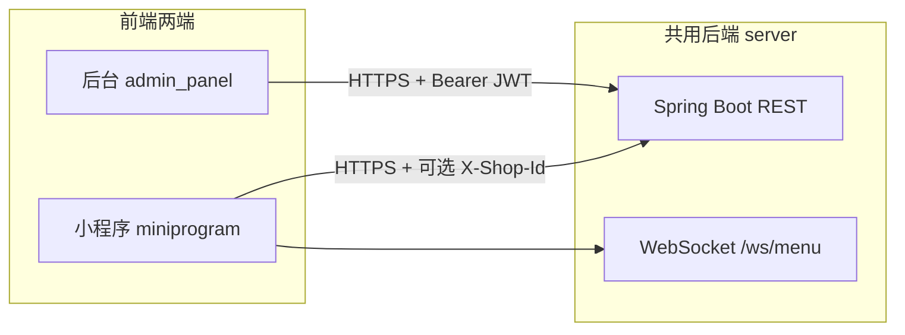
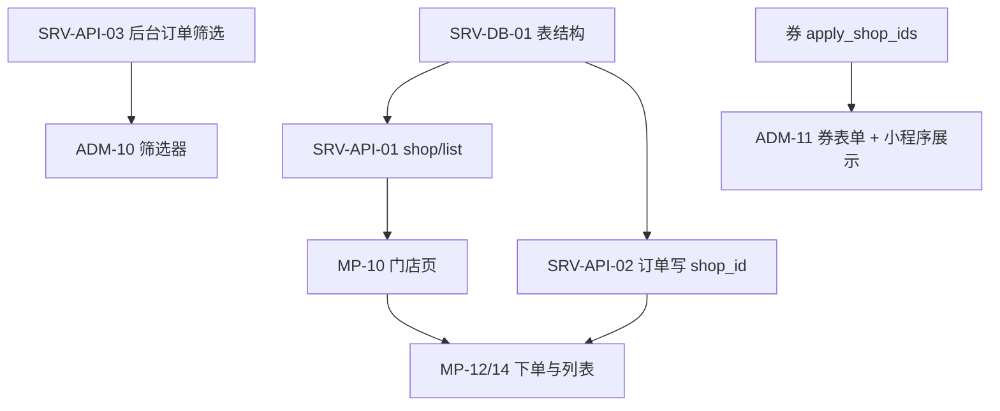

# 连锁模式 — 三端分离接口与协作规范

> **版本**：2.0（2026-04-03）  
> **读者**：小程序前端、运营后台前端、共用后端开发；以及 **AI 编码助手**（按章节任务包执行）。  
> **依据**：`docs/openapi.yaml`、`docs/db_diancan.sql`、`docs/db_diancan_chain_store_patch.sql`、`docs/db_chain_store_design.md`。运营后台连锁权限与门店 **`code`** 体系见 **`docs/admin_chain_permission_architecture.md`**。  
> **原则**：**一份 OpenAPI = 唯一 HTTP 契约**；三端只通过契约与约定字段通信，禁止隐式魔法字符串。

---

## 0. 文档怎么用（给 AI / 分工）

| 使用方式 | 说明 |
|----------|------|
| **按端领任务** | 直接跳转到 **§5 小程序**、**§6 后台**、**§7 后端**，每条「任务包」含输入、输出、依赖、验收标准。 |
| **联调** | 用 **§8 接口分端索引** + **§4 门店上下文** 对齐 Header/Body。 |
| **改库** | 先读 `docs/db_chain_store_design.md`，再执行/合并 `docs/db_diancan_chain_store_patch.sql`。 |
| **更新契约** | 改 Java 接口行为时 **必须同步** `docs/openapi.yaml`，并在 PR 说明里引用本文件章节号。 |

---

## 1. 三端架构与仓库

本仓库为 **Monorepo（或同工作区多目录）**，三端职责如下：

| 端 | 工程路径（本仓库） | 技术栈（以现有为准） | 访问后端的身份 |
|----|-------------------|----------------------|----------------|
| **小程序** | `miniprogram/` | 微信小程序 + 现有框架（如 uni-app / 原生等） | `openid` / `code`，**无 JWT** |
| **运营后台** | `admin_panel/` | Web（如 Vue） | `Authorization: Bearer <JWT>` |
| **后端** | `server/` | Java Spring Boot | 提供 REST + WS + 支付回调 |

**不包含在本文件但需知晓**：收银机/POS 若使用 `/cashier/*`，与后台类似走 JWT，门店维度见 **§7.4**。

---

## 2. 职责边界（前后端分离）

| 能力 | 小程序 | 后台 | 后端 |
|------|--------|------|------|
| 选择/记忆当前门店 | ✅ 全局状态 + 本地存储 | ✅ 顶部门店筛选器 / 数据范围 | ✅ 校验 `shop_id`、落库、拒绝跨店非法写 |
| 菜单展示 | ✅ 请求列表、渲染、下拉刷新 | ✅ CRUD、上下架、排序 | ✅ 数据与库存规则、WS 推送 |
| 下单/支付 | ✅ UI、调起支付 | ✅ 代客下单（若有）、订单运维 | ✅ 金额校验、库存事务、回调 |
| 门店主数据维护 | ❌ 只读列表（C 端接口） | ✅ 表单维护 | ✅ `/admin/shop/*` 持久化 |
| 权限与菜单 | ❌ | ✅ 路由守卫、按钮级权限码 | ✅ JWT + `t_api_permission` 等 |
| 券/活动 | ✅ 领取、展示、下单勾选 | ✅ 模板配置 | ✅ 核销规则、门店范围 |

**硬规则**：小程序 **不得** 调用仅标注为 B 端且需 JWT 的接口（除非产品明确要求嵌入管理端，一般不这么做）。

---

## 3. 统一契约

### 3.1 HTTP 响应（三端解析一致）

与现网一致：

- **成功**：`code === 0`（或 `0`），业务字段在**同级**或约定字段名（以各接口实际 JSON 为准；AI 实现时 **对照 openapi 示例**）。  
- **失败**：`code !== 0`，`msg` 为人类可读中文。  
- **HTTP 状态**：多数业务错误仍可能返回 `200` + `code != 0`；401/403 主要用于 B 端鉴权失败。

### 3.2 鉴权

| 端 | 请求头 | 说明 |
|----|--------|------|
| 小程序 | 按现有项目：如 `openid` 放 body/query/header（**保持与现有一致**） | 新增连锁时 **叠加** `X-Shop-Id`（推荐） |
| 后台 | `Authorization: Bearer <token>` | token 来自 `/adminLogin` 或项目现有登录接口 |
| 支付回调 | 微信服务器 POST | 无用户 JWT；靠签名与订单号 |

### 3.3 门店上下文（连锁核心）

**语义**：`shop_id` 为整数，对应 `t_shop.id`。

**传递优先级（后端实现顺序，与 `ShopChainSupport` 一致）**：

1. `X-Shop-Id: <int>`  
2. `X-Shop-Code: <string>`（查 `t_shop.code`，须为营业中门店）  
3. Query：`?shop_id=`  
4. Query：`?shop_code=`（同 `X-Shop-Code` 语义）  
5. JSON Body：`shop_id` / `shop_code`（若该接口接收 body）  
6. 兼容：仅当产品约定 `merchantId` 表示 `t_shop.code` 时，才用 `merchantId` 解析为 `shop_id`  

**一致性**：同一侧（仅 header 或仅 body）若同时给出 **ID 与 Code**，二者须解析为**同一门店**；header 解析结果与 body 解析结果同时存在时亦须一致。

**校验**：门店存在且 `status = 1`（营业），否则 `code != 0`，`msg` 如「门店不可用或不存在」。

**建议业务码**（可选，便于前端分支处理）：

| code | 含义 |
|------|------|
| 4001 | 缺少必选门店上下文 |
| 4002 | 门店不存在或停用 |
| 4003 | 资源不属于当前门店（订单、券、原料、支付方式等跨店访问或篡改） |
| 4004 | 桌台与门店不匹配 |

---

## 4. 门店上下文全链路（跨三端）

下列步骤便于联调与 AI 生成端到端逻辑：

1. **用户打开小程序** → 读本地 `currentShopId`；若无 → 进入 **门店选择页**。  
2. **门店选择页** → 调 `GET /shop/list`（待后端实现）或使用过渡方案 → 用户选中 → 写入 `currentShopId`（`storage` + 全局 store）。  
3. **后续所有 C 端 API** → 封装层自动带 `X-Shop-Id: currentShopId`（或与后端约定字段一致）。  
4. **扫码点单** → 二维码载荷应含 `shop_id` 或 `shop_code`；解析后若与 `currentShopId` 不一致，**提示切换门店**或自动切换（产品定）。  
5. **后台登录** → 加载可管理门店列表（`shops` / `GET /admin/me/shops`）→ 顶栏选店 → **后续业务请求须带 `X-Shop-Id` 或 `X-Shop-Code`**（与 `ShopChainSupport` 解析规则一致）；**勿**仅依赖 body/query 中的 `shop_id` 作为唯一依据（服务端以拦截器解析结果为准，防伪造）。  
6. **后端写订单** → 持久化 `t_order.shop_id`；后续支付、取消、加菜均校验与订单一致。

---

## 5. 小程序前端任务包（miniprogram）

### 5.1 基础设施（优先）

| 任务 ID | 描述 | 输入 | 输出 | 验收 |
|---------|------|------|------|------|
| MP-01 | **HTTP 封装**：统一 `baseURL`、超时、错误 toast | 环境变量或 `config.js` | 所有业务请求走封装函数 | 改一处 baseURL 全局生效 |
| MP-02 | **门店上下文**：`getCurrentShopId` / `setCurrentShopId` | 用户选择门店 | 持久化到 `wx.setStorageSync('currentShopId')` 等 | 杀进程重启后仍能读取（除非用户清除） |
| MP-03 | **请求拦截**：在封装内自动附加 `X-Shop-Id` | 当前门店 id | 每个需要门店的 API 自动带头 | 用抓包或日志确认 |
| MP-04 | **无门店降级**：`currentShopId` 为空时 | — | 跳转门店选择页；禁止进点餐核心页 | 体验符合产品 |

### 5.2 页面与流程

| 任务 ID | 描述 | 依赖接口（目标契约） | 验收 |
|---------|------|----------------------|------|
| MP-10 | **门店列表页** | `GET /shop/list`（待后端）；字段：`id,name,code,address,contact_phone,open_time,close_time,latitude,longitude`（可选） | 仅展示 `status=营业`；选中后 MP-02 |
| MP-11 | **首页/点餐入口** | 依赖 MP-04 | 显示当前门店名称；提供「切换门店」 |
| MP-12 | **菜单页** | `GET /dish/listAll`（可选 `shop_id` query 与 Header 二选一，**与后端对齐**） | 切换门店后菜单刷新 |
| MP-13 | **WebSocket** | `ws(s)://host/ws/menu`；若支持 `?shopId=` | 重连时带当前 `shop_id` | 切店后断开旧连接、连新订阅（若后端支持） |
| MP-14 | **下单/订单列表** | `POST /order/create` 等 | body 或 header 与 openapi 一致；订单列表按店过滤 | 不串店 |

### 5.3 小程序侧禁止事项

- 不要把 `shop_id` 只放在内存而不持久化（除非产品要求每次必选店）。  
- 不要假设 `merchantId` 等于门店 id；**新链路以 `shop_id` 为准**。  
- 不要硬编码门店列表作为最终方案（仅可做过渡）。

---

## 6. 运营后台前端任务包（admin_panel）

### 6.1 基础设施

| 任务 ID | 描述 | 验收 |
|---------|------|------|
| ADM-01 | Axios/fetch 封装：`Authorization` 自动附加 | 401 跳转登录 |
| ADM-02 | 权限指令/路由 meta：与 `docs/权限设计.md`、openapi `x-permission` 对齐 | 无权限菜单不可见或按钮禁用 |
| ADM-03 | 登录态范围恢复：启动调用 `GET /admin/me/permissions`，回填 `scope/shops/regionIds` | 刷新后状态与后端一致 |

### 6.2 连锁相关 UI

| 任务 ID | 描述 | 依赖接口 | 验收 |
|---------|------|----------|------|
| ADM-10 | **门店筛选器**（订单/报表/日结、券/会员/库存/日志等页） | 与后端一致：HTTP Header **`X-Shop-Id`** / **`X-Shop-Code`**（及拦截器白名单约定）；报表/日结等**数据范围**以解析后的门店为准 | 切换门店后列表刷新；勿单独伪造 query `shop_id` |
| ADM-10A | **门店分页懒加载**（HQ/多店） | `GET /admin/me/shops?page=&pageSize=&keyword=` | 门店量大时不一次性加载全量 |
| ADM-11 | **门店 CRUD 页** | `GET/POST /admin/shop/list`、`/admin/shop/save` | 表单字段与 `t_shop` 及补丁列一致 |
| ADM-12 | **优惠券表单** | 保存时带 `apply_shop_ids`（JSON 字符串或多选组件序列化） | 与后端字段名一致 |
| ADM-13 | （P3）**管理员门店数据范围** | 登录后拉取可管理 `shop_id` 列表 | 筛选器默认限定范围 |

### 6.3 与 OpenAPI 同步方式

- 每个新表单字段：**先在 openapi 的 requestBody schema 出现**，再写前端表单。  
- AI 生成代码时提示词示例：「根据 `docs/openapi.yaml` 中 `/admin/shop/save` 的 schema 生成 Vue 表单，字段绑定与校验一致」。

---

## 7. 后端任务包（server，共用）

### 7.1 分层建议（便于 AI 按层改）

| 层 | 职责 | 连锁相关 |
|----|------|----------|
| Controller | 参数解析、鉴权入口 | 读取 `X-Shop-Id`、JWT |
| Service | 业务规则、事务 | 校验订单 `shop_id`、券门店范围 |
| Mapper/Entity | 与表字段一致 | `Order.shop_id` 等 |
| 拦截器（可选） | 解析门店上下文到 `ThreadLocal` 或方法参数 | 减少每个方法重复解析 |

### 7.2 数据库与实体（P0）

| 任务 ID | 描述 | 验收 |
|---------|------|------|
| SRV-DB-01 | 执行 `docs/db_diancan_chain_store_patch.sql` 中 P0 段 | `t_order.shop_id`、`t_table.shop_id` 可写可读 |
| SRV-DB-02 | MyBatis-Plus 实体 `Order`、`Table` 等增加 `shopId` 映射 | 与表字段一致 |
| SRV-DB-03 | 历史数据回填脚本（手工或一次性 job） | 单店环境可 `UPDATE ... SET shop_id=1` |

### 7.3 接口实现（与 openapi 同步）

| 任务 ID | 描述 | 验收 |
|---------|------|------|
| SRV-API-01 | 新增 `GET /shop/list`（公开或弱鉴权），只返回营业门店 | openapi 有 path；小程序可联调 |
| SRV-API-02 | `POST /order/create`（及加菜/取消）写入并校验 `shop_id` | 跨店改单失败；错误信息明确 |
| SRV-API-03 | 管理端订单列表支持 `shop_id` 过滤 | 与 ADM-10 联调 |
| SRV-API-04 | 优惠券：`apply_shop_ids` 领取/核销校验 | 不符合门店则不可用 |
| SRV-API-05 | （P2）`GET /dish/listAll` 支持门店覆盖表 `t_dish_shop` | 价格库存规则见 `db_chain_store_design.md` |

### 7.4 收银端（若同属本后端）

- 已有 `shopId` 的接口保持与订单 `shop_id` 一致。  
- JWT 载荷或登录接口返回「允许操作的门店列表」，与 `t_admin_shop`（可选）对齐。

### 7.5 日志与审计

- 关键写操作日志带 `shop_id`（`t_order_log` 补丁列）。  
- 日志中同时打 `order_no`、`openid`/`admin_id`，便于排障。

### 7.6 运营后台数据隔离（已实现，与 `SysInterceptor` 对齐）

> 迁移：`docs/db_migration_material_payment_log_shop_id.sql`（原料、出入库、支付方式、操作日志的 `shop_id`）。优惠券、订单等沿用既有字段（`apply_shop_ids`、`t_order.shop_id`）。

| 模块 | 路径前缀（示例） | 行为摘要 |
|------|------------------|----------|
| 拦截器 | `/admin/**`（白名单除外）、`/cashier/**` | 须解析出门店上下文，否则 **4001**；白名单见 `SysInterceptor.ADMIN_SHOP_CONTEXT_EXEMPT_PREFIXES`（如 `/admin/me/`、`/admin/shop/list`、`/admin/rbac/`、`/admin/config/`、`/admin/unit/`、`/admin/order/auto-accept` 等）。 |
| 订单/报表/日结/桌台/菜品/类目 | `/admin/order/*`、`/admin/report/*`、`/admin/daily/*`、`/admin/table/*`、`/admin/dish/*`、`/admin/category/*` | 列表与统计按 **`AdminShopRequest` 解析的门店**过滤或校验；不信任单独传来的 query/body `shop_id` 作为数据范围。 |
| 总部菜导入门店 | **`POST /admin/dish/hqTemplateList`**、**`POST /admin/dish/importFromHq`** | **`hqTemplateList`**：全量 **`t_dish`** 分页（不按 **`t_dish_shop`**），与 **`POST /admin/dish/list`** 同响应结构；**`importFromHq`**：按当前店 **`INSERT IGNORE`** **`t_dish_shop`**，去重、不复制 **`t_dish`**，**`typeId`** 沿用总部类目。 |
| 优惠券 | `/admin/coupon/*` | 列表/详情/改删按 `apply_shop_ids`（JSON 数组）是否包含当前店；空/未配置表示全部门店。新增时若未传 `apply_shop_ids`，默认写入**仅当前店**。 |
| 会员 | `/admin/member/*` | **消费记录、画像**所基于的订单按 `t_order.shop_id` 过滤；**储值**为 `t_user.balance`（按用户）。 |
| 原料与库存 | `/admin/material/*` | `t_material` / 出入库记录带 `shop_id`；列表、保存、入出库、预警均按当前店；跨店原料 ID 操作返回 **4003**。 |
| 支付方式 | `/admin/payment-method/*` | 列表：`shop_id IS NULL`（全局）或 `shop_id = 当前店`；新店方式写入当前店；不可篡改他店专属行；全局行更新时保持 `shop_id` 为 `NULL`。 |
| 操作日志 | `/admin/log/operation` | 门店账号仅可查授权门店；总部不传门店时查全局/未归店日志，`allShops=true` 可查全部门店。401/403、C 端身份不一致、KDS 鉴权失败及权限配置变更写 `module=security`。 |
| 订单操作日志 | `GET /admin/order/log/{orderId}` | 先校验订单归属当前店再返回 `t_order_log`。 |

实现入口：`com.lanf.util.AdminShopRequest`、`com.lanf.util.CouponShopFilter`；错误码 **4003** 表示资源不属于当前门店。

---

## 8. 接口分端索引（谁调用什么）

> 路径以 `docs/openapi.yaml` 为准；下表为 **连锁场景下的调用方**。

| 路径（示例） | 小程序 | 后台 | 说明 |
|--------------|--------|------|------|
| `/order/getOpenid` | ✅ | ❌ | 登录第一步 |
| `/shop/list` | ✅ | 可选 | **建议新增**，小程序必选 |
| `/admin/shop/list` | ❌ | ✅ | 需 `shop:manage` |
| `/admin/shop/save` | ❌ | ✅ | 同上 |
| `/dish/listAll` | ✅ | ❌ | C 端菜单；可带 `shop_id` |
| `/admin/dish/*` | ❌ | ✅ | 管理菜品 |
| `/order/create` | ✅ | 视业务 | **必须带门店上下文** |
| `/admin/order/*` | ❌ | ✅ | 须门店上下文；数据按解析后的 `shop_id`（见 §7.6） |
| `/admin/daily/*`、`/admin/report/*` | ❌ | ✅ | **门店以 Header 解析为准**（见 §7.6） |
| `/admin/coupon/*`、`/admin/member/*`、`/admin/material/*`、`/admin/payment-method/*`、`/admin/log/*` | ❌ | ✅ | 须带门店上下文；见 §7.6 |
| `/ws/menu` | ✅ | 可选 | 小程序监听菜单变更 |

---

## 9. C 端接口模块说明（连锁补充）

以下与 v1.0 一致，**略展字段级细节**；完整 schema 见 openapi。

### 9.1 认证与用户

| 方法 | 路径 | 连锁说明 |
|------|------|----------|
| POST | `/order/getOpenid` | 与门店无关 |
| POST | `/order/getUserInfo` | 与门店无关 |

### 9.2 门店列表

| 方法 | 路径 | 说明 |
|------|------|------|
| GET | `/shop/list` | `page,size` 可选；**仅营业门店**；可返回 `sort_order` 供前端排序 |

### 9.3 桌台与营业

- 扫码参数：`shop_id` 或 `shop_code` + `table`/`qrcode` 等（与现网生成规则一致）。  
- `ChangeBusiness`：若按店维度，后端读写需带 `shop_id`（实现前在 openapi 标注参数）。

### 9.4 菜品与订单、支付、券、WS

- 与 **§5、§7** 及 openapi 顶层「库存与下单/取消」一致。  
- 券：同时满足 `apply_dish_ids`、`apply_dining_type`、`apply_shop_ids`（待库表与代码齐全）。

---

## 10. 迭代里程碑（依赖顺序）

| 阶段 | 内容 | 三端交付物 |
|------|------|------------|
| **M1** | DB P0 + `shop/list` + 创建订单写 `shop_id` | 后端 + 小程序选店 + 下单 |
| **M2** | 订单列表/详情按店过滤 + 后台筛选 | 后端 + 小程序 + 后台 |
| **M3** | 券门店范围 + 校验 | 后端 + 后台配置 + 小程序下单页 |
| **M4** | `t_dish_shop` + 菜单按店 | 后端 + 小程序菜单 |
| **M5** | WS 按店、管理员门店数据权限 | 后端 + 小程序 + 后台 |

---

## 11. 联调检查清单（人工 / AI 自测）

- [ ] 小程序未选门店时，无法发起 `create`（或后端明确报错 4001）。  
- [ ] 切换门店后，订单列表不包含其他店订单。  
- [ ] 后台切换门店后，网络请求中 **`X-Shop-Id` / `X-Shop-Code`**（及与 UI 选中门店）一致；业务数据范围与 §7.6 一致。  
- [ ] 同一 `openid` 在 A 店下单，请求不会写入 B 店 `shop_id`（除非二维码强制切店且用户确认）。  
- [ ] openapi 与真实 Controller 路径、方法、参数名 **一致**（大小写含 `shop_id` vs `shopId` 以**后端实际**为准，文档中统一说明映射）。

---

## 12. 给 AI 的开发提示词模板（可直接复制）

**小程序（门店 + 请求封装）**  
> 你在仓库 `miniprogram/` 工作。根据 `docs/backend_chain_store_api.md` §5 与 `docs/openapi.yaml`，实现：① 本地存储的 `currentShopId`；② HTTP 封装自动添加 `X-Shop-Id`；③ 门店列表页调用 `GET /shop/list`；④ 未选门店时拦截进入点餐页。保持现有项目请求风格，不要引入与现网冲突的鉴权方式。

**后台（门店筛选 + 门店管理）**  
> 你在仓库 `admin_panel/` 工作。根据 `docs/openapi.yaml` 中 `/admin/shop/*` 与订单列表接口，实现门店下拉筛选，query 参数名为 `<与 openapi 一致>`。权限与路由按 `docs/权限设计.md`。

**后端（订单 shop_id）**  
> 你在仓库 `server/` 工作。已执行 `docs/db_diancan_chain_store_patch.sql` 中订单与桌台相关变更。请为 `Order` 实体与 `OrderController` 创建订单流程增加 `shop_id` 解析（优先级见 `docs/backend_chain_store_api.md` §3.3）、校验与持久化，并更新 `docs/openapi.yaml` 对应 requestBody 与示例。

---

## 13. 安全与审计（摘要）

- **不信任**前端单独传来的 `shop_id`：需与订单已有数据、桌码、支付单交叉验证（见各接口实现）。  
- B 端敏感操作写 `t_order_log` / `t_operation_log`，并带 `shop_id`（补丁列）。  
- 默认允许任意用户向任一下单门店下单；若未来限制，单独加黑名单/区域表。

---

## 14. 与 OpenAPI 的维护关系

- **唯一契约**：`docs/openapi.yaml`。  
- 本文件描述**三端分工、任务顺序、门店语义**；字段级以 openapi 为准。  
- 完成任一 SRV-API / MP / ADM 任务后：**同步更新 openapi** 与本文件相关表格（如有路径或参数变更）。

---

**文档结束。**
