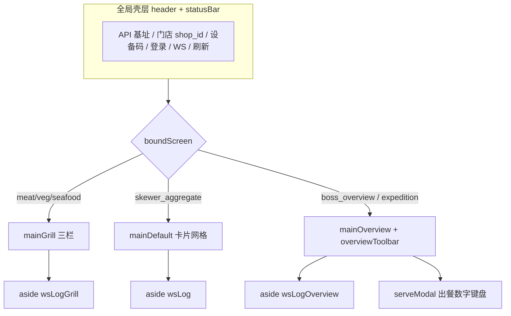

# KDS 厨显前端开发任务清单（对照 demo 架构）

> **版本**：2026-05-31  
> **契约**：`server/docs/openapi.yaml`（标签 **KDS-Client** / **KDS-Admin**）  
> **联调演示**：`http://<host>/kds-demo.html`（静态页 `server/src/main/resources/static/kds-demo.html`）  
> **运营配置**：`server/docs/kds_admin_setup_guide.md`  
> **范围**：厨显 App / Web（平板横屏）；**不含** `admin_panel` 配置页（另见 KDS-Admin 任务节）

---

## 1. demo 页面架构（前端应对齐的壳层）

### 1.1 布局分区

demo 用 **「屏类型 → 主布局」** 切换，生产端建议固化为路由或启动参数（每台设备只绑一种 `screen_tag`）。




| DOM 区域                            | 屏型                                               | 说明                         |
| --------------------------------- | ------------------------------------------------ | -------------------------- |
| `header`                          | 全部                                               | 登录、WS、手动刷新；**仅「登录」改服务端绑定** |
| `overviewToolbar`                 | `boss_overview`、`expedition`                     | 队列 / 就餐 / 视图 / 特殊筛选 chips  |
| `mainGrill`                       | `meat_grill`、`veg_grill`、`seafood_special`       | 左桌号 / 中固定位 / 右制作中          |
| `mainDefault` + `#orders`         | `skewer_aggregate`、兜底列表                          | 卡片网格 + 右侧 WS 日志            |
| `mainOverview` + `#overviewCards` | `boss_overview`、`expedition`                     | 看板卡片 + WS                  |
| `serveModal`                      | `expedition` + `queue=ready_serve` + `view=dish` | 0–9 分批传菜                   |


### 1.2 会话与数据流（demo 已实现，正式端须复刻）


| 步骤   | demo 行为                                                  | 生产要求                           |
| ---- | -------------------------------------------------------- | ------------------------------ |
| 登录   | `POST /kds/device/login` → 存 `device_token`、`screen_tag` | 开机自动登录；token 持久化（安全存储）         |
| 真相源  | `boundScreen` 以 **token 绑定** 为准，下拉改屏 ≠ 改绑定               | 设备出厂/设置页选屏后登录；禁止运行时随意换屏（或二次确认） |
| 同步绑定 | `GET /kds/device/me`（刷新前）                                | 401 / 屏不一致时提示重新登录              |
| 拉数   | `refreshList()` 按屏分支不同 API                               | 见 §3 各屏                        |
| WS   | `/ws/kds?shop_id&screen_tag&token`；15s `ping`            | 断线重连、退避；忽略 `screen_tag` 非本桶消息  |
| 推送刷新 | `scheduleRefreshAfterPush` 350ms 防抖                      | 列表/看板全量刷新（P1 可改增量）             |
| 多屏同店 | **不同 `device_code`**                                     | 文档与 UI 强提示，避免 token 互踢         |


### 1.3 统一 API 封装（建议抽模块）

对照 demo `api()` / `apiOk()`：

- Header：`X-Kds-Device-Token`（除 login）
- 响应：`code === 0` 或 `200` 为成功；`msg` 错误文案
- 401 +「设备未绑定」→ 清 session，回登录页

---

## 2. 屏型与接口对照（开发主索引）


| screen_tag                                     | 主布局（对齐 demo）                  | 主接口                         | 写操作                                                                           |
| ---------------------------------------------- | ----------------------------- | --------------------------- | ----------------------------------------------------------------------------- |
| `skewer_aggregate`                             | `mainDefault` 按菜卡片            | `GET /kds/skewer/summary`   | `POST /kds/skewer/picked`                                                     |
| `meat_grill` / `veg_grill` / `seafood_special` | `mainGrill` 三栏                | `GET /kds/grill/board`      | `POST /kds/grill/start-cooking`、`POST /kds/item/status`、`POST /kds/item/lack` |
| `expedition`                                   | `mainOverview` + `serveModal` | `GET /kds/expedition/board` | `POST /kds/expedition/serve`（仅待传菜）                                            |
| `boss_overview`                                | `mainOverview`（只读）            | `GET /kds/overview/board`   | 无                                                                             |


**兜底**：未单独实现的屏仍可用 `GET /kds/order/list`（demo 遗留路径）；**出餐/总览以 board 为准**。

**单品状态**：`POST /kds/item/status` — `detail_id` + `status`（0/1/2/3）+ 可选 `screen_tag`。

---

## 3. 分屏功能任务详情

### 3.1 全局壳层（P0）


| ID   | 任务            | 说明                                          | 验收                       |
| ---- | ------------- | ------------------------------------------- | ------------------------ |
| G-01 | 设备登录页         | `shop_id`、`device_code`、`screen_tag`（或出厂写死） | 登录成功展示屏名称、门店名            |
| G-02 | Token 生命周期    | 本地存储 + 启动 `device/me` 校验                    | token 失效跳转登录             |
| G-03 | HTTP 客户端      | 基址配置（环境切换）                                  | 与 openapi 字段一致           |
| G-04 | WebSocket 客户端 | 连接参数与 demo `wsUrl()` 一致                     | 收 `new_order` 后 1s 内列表更新 |
| G-05 | 心跳            | `POST /kds/device/heartbeat`（建议 60s）        | 后台可见 `last_heartbeat_at` |
| G-06 | 布局路由          | `showLayout(screen)` 四态                     | 错屏访问 API 403 时有明确提示      |
| G-07 | 状态栏           | 汇总 ticket/单量/连接状态                           | 与 demo `statusBar` 同级信息  |
| G-08 | 手动刷新          | 按钮触发 `refreshList`                          | 离线恢复后可拉全量                |
| G-09 | 多设备规范         | UI 提示「一屏一码」                                 | 同码双开仅后登录者有效              |


### 3.2 抓串屏 `skewer_aggregate`（P0）

**布局**：`mainDefault` — 按 `dish_name` 卡片，显示 `quantity`、`unit`、`target_screens`。


| ID   | 任务   | API                                                        | 验收                     |
| ---- | ---- | ---------------------------------------------------------- | ---------------------- |
| S-01 | 汇总列表 | `GET /kds/skewer/summary`                                  | `skewer_gate=1` 时有待抓菜品 |
| S-02 | 已抓齐  | `POST /kds/skewer/picked` body: `dish_name` 或 `detail_ids` | 抓串屏 WS/刷新后该行消失；烤制屏出现待做 |
| S-03 | 空态   | —                                                          | 文案区分「闸门关闭 / 已全部抓齐」     |
| S-04 | WS   | `new_order`（抓串桶）                                           | 新单出现在汇总                |


**注意**：`picked` 后工单仍为 `item_status=0`，仅 `skewer_picked=1`。

### 3.3 烤制屏 `meat_grill` / `veg_grill` / `seafood_special`（P0）

**布局**：`mainGrill` 三栏（demo 核心）。

#### 左栏 · 桌号队列 `table_queue[]`


| ID   | 任务   | 字段/交互                                                     | 验收                             |
| ---- | ---- | --------------------------------------------------------- | ------------------------------ |
| R-01 | 桌卡列表 | `table_number`、`order_no`、`orderNumber`、`dineInOrTakeOut` | 加急 `rush_flag` 金边              |
| R-02 | 超时标红 | `overdue_flag`（桌卡或明细）                                     | `sla_minutes` 来自 board 响应      |
| R-03 | 明细行  | `name`、`quantity`、`wait_seconds`                          | 展示未抓串 tag（`skewer_picked=0` 时） |
| R-04 | 制作   | `POST /kds/item/status` status=1                          | 该行从左栏消失                        |
| R-05 | 缺货   | `POST /kds/item/lack`                                     | 工单作废、可选售罄                      |


#### 中栏 · 固定位 `product_slots[]`


| ID   | 任务    | 字段/交互                                           | 验收              |
| ---- | ----- | ----------------------------------------------- | --------------- |
| R-06 | 固定位网格 | `dish_name`、`quantity`、`unit`                   | 绑定屏 + 门店上架才有格   |
| R-07 | 灰显    | `clickable=0` / `quantity=0`                    | 不可点击            |
| R-08 | 超时    | `overdue_flag`                                  | 红框/红字           |
| R-09 | 合并制作  | `POST /kds/grill/start-cooking` `{ dish_name }` | 返回整板数据；左栏该菜待做清空 |
| R-10 | 二次确认  | 弹窗「合并 N 串开始制作」                                  | 防误触             |


#### 右栏 · 制作中 `cooking_groups[]`


| ID   | 任务  | 字段/交互                                                 | 验收                            |
| ---- | --- | ----------------------------------------------------- | ----------------------------- |
| R-11 | 合并行 | `dish_name`、`quantity`、`table_numbers`、`wait_seconds` | 多桌同菜一行                        |
| R-12 | 完成  | 对 `detail_ids[]` 循环 `status=2`                        | 出餐屏待传菜出现；WS 推 expedition/boss |
| R-13 | 空态  | —                                                     | 「暂无制作中」                       |


| ID   | 任务    | API                                | 验收         |
| ---- | ----- | ---------------------------------- | ---------- |
| R-14 | 拉板    | `GET /kds/grill/board?screen_tag=` | 三栏数据一致     |
| R-15 | WS 刷新 | `update_order`                     | 防抖刷新 board |


### 3.4 出餐屏 `expedition`（P0）

**布局**：与收银总览相同壳 + **出餐专属写操作**。


| ID   | 任务      | 说明                                                                    | 验收                          |
| ---- | ------- | --------------------------------------------------------------------- | --------------------------- |
| E-01 | 看板拉取    | `GET /kds/expedition/board?queue&dining&view&extra`                   | 默认 `queue=ready_serve`      |
| E-02 | 工具栏     | 同 demo `overviewToolbar`                                              | 切换队列/视图即时刷新                 |
| E-03 | 待传菜展示   | `quantity` = `remaining_quantity`；`line_quantity` / `served_quantity` | 油边王 10 串显示待传 10             |
| E-04 | 标签      | `item_status_label`、催/加菜/等叫                                           | 与总览一致                       |
| E-05 | 点击传菜    | 仅 `view=dish` + `ready_serve` + `serve_clickable`                     | 打开数字键盘                      |
| E-06 | 数字键盘    | 0–9、清空、退格、确认                                                          | UX 对齐 `serveModal`          |
| E-07 | 提交传菜    | `POST /kds/expedition/serve` `{ dish_name, quantity, screen_tag? }`   | 传 5 后剩 5；按 `done_at` 先后扣减   |
| E-08 | 校验      | `quantity <= remaining`                                               | 超限提示后端文案                    |
| E-09 | WS      | `update_order`（`served_quantity` / `item_status=2`）                   | 卡片数量更新                      |
| E-10 | 自动切 Tab | 收到完成推送时 `pending/cooking` → `ready_serve`                             | 对齐 demo `onWsBusinessEvent` |


**不做**：出餐屏不应依赖旧 `GET /kds/order/list` 作为主界面。

### 3.5 收银总览 `boss_overview`（P0）


| ID   | 任务   | 说明                                                           | 验收                                         |
| ---- | ---- | ------------------------------------------------------------ | ------------------------------------------ |
| B-01 | 看板   | `GET /kds/overview/board`                                    | 与出餐相同 query，**无** serve 按钮                 |
| B-02 | 队列语义 | `pending`=仅0；`cooking`=仅1；`ready_serve`=2未归档；`done`=archived | 制作中不出现在待制作                                 |
| B-03 | 视图   | `dish` / `order` / `table`                                   | 按菜显示 `pending_quantity`/`cooking_quantity` |
| B-04 | 筛选   | `extra=overdue,rush,add_dish,hold`                           | chips 多选                                   |
| B-05 | 只读   | 无划菜按钮                                                        | 403 若调写接口                                  |
| B-06 | WS   | 接收各岗扇出推送                                                     | 筛选条件保持下刷新                                  |


### 3.6 扩展能力（P1 / P2）


| ID   | 任务     | API                                  | 优先级    |
| ---- | ------ | ------------------------------------ | ------ |
| X-01 | 订单列表兜底 | `GET /kds/order/list`                | P2（调试） |
| X-02 | 催菜     | `POST /kds/order/rush`               | P1     |
| X-03 | 整单完成   | `POST /kds/order/finish-all`         | P2     |
| X-04 | 今日统计   | `GET /kds/stats/today`               | P2     |
| X-05 | 离线同步   | `POST /kds/sync/all`（`client_id` 幂等） | P1 弱网  |
| X-06 | 增量同步   | `GET /kds/sync/changes?since=`       | P2     |
| X-07 | 缺货原因   | `lack` 带 `remark`                    | P1     |
| X-08 | 语音/大屏  | 新单提示音                                | P2 体验  |


---

## 4. WebSocket 事件（前端订阅表）


| type                   | 处理建议                           | 影响屏     |
| ---------------------- | ------------------------------ | ------- |
| `new_order`            | 防抖刷新主界面                        | 本屏 + 总览 |
| `update_order`         | 刷新；总览/出餐：完成或传菜可切 `ready_serve` | 全部相关    |
| `cancel_item`          | 刷新或移除行                         | 烤制、总览   |
| `cancel_order`         | 刷新                             | 全部      |
| `order_status_changed` | 整单态变更（可选展示）                    | 总览      |
| `pong`                 | 忽略                             | —       |


**payload 常用字段**：`detail_id`、`order_id`、`item_status`、`dish_name`、`served_quantity`、`screen_tag`、`source_screen_tag`。

---

## 5. UI 规范（从 demo 样式提炼）


| 语义    | CSS 类 / 规则                                                          | 使用场景       |
| ----- | ------------------------------------------------------------------- | ---------- |
| 加急    | `.card.rush` 左边框 `#ffc107`                                          | 桌卡、菜卡      |
| 超时    | `.card.overdue` / `.item.overdue` / `.slot.overdue`                 | 左栏桌、中栏格    |
| 制作中   | `.item.cooking` 左边框黄                                                | 右栏         |
| 待传可点  | `.card.serve-click` 绿左边框                                            | 出餐屏        |
| 标签    | `.tag-rush` / `tag-overdue` / `tag-add` / `tag-hold` / `tag-status` | 明细行        |
| 固定位空闲 | `.slot.idle` 半透明                                                    | quantity=0 |


生产端建议：**横屏 1280×800+**、字号 ≥ demo、触控热区 ≥ 44px。

---

## 6. 运营后台（admin_panel）前端任务摘要

> 后端已就绪，配置类前端通常在 `admin_panel` 另立项。


| ID   | 页面       | 接口                                  |
| ---- | -------- | ----------------------------------- |
| A-01 | KDS 门店设置 | `GET/POST /admin/kds/config/get     |
| A-02 | 五屏初始化    | `POST /admin/kds/station/init-five` |
| A-03 | 菜品绑屏     | `GET/POST /admin/kds/dish-screen/*` |
| A-04 | 分类绑档口    | `station/category/*`                |
| A-05 | 设备管理     | `device/list                        |
| A-06 | 工单补推     | `POST /admin/kds/ticket/repush`     |


详见 `kds_admin_setup_guide.md`。

---

## 7. 建议迭代顺序

```text
Phase 0（联调）
  G-01～G-09 + S-01～S-04 + R-14/R-15

Phase 1（烤制主路径）
  R-01～R-13 + E-01～E-10

Phase 2（总览 + 弱网）
  B-01～B-06 + X-05

Phase 3（体验）
  X-02、X-07、X-08、虚拟列表、增量 WS
```

---

## 8. demo 与正式端差异清单


| 项     | demo                         | 正式 App          |
| ----- | ---------------------------- | --------------- |
| 屏切换   | 下拉 + 登录                      | 出厂绑定或管理密码       |
| WS 日志 | 右侧三份 `wsLog*`                | 可隐藏；生产记文件       |
| 完成批量  | `finishCookingGroup` 循环 HTTP | 可封装批量接口或队列      |
| 出餐视图  | `order`/`table` 仅展示          | P1 支持按桌传菜（若产品要） |
| 配置    | 手写 API 地址                    | 内置环境 / 扫码配网     |
| 离线    | 无                            | `sync/all` 队列   |


---

## 9. 联调检查表

1. 执行 `db_migration_kds.sql`、`db_migration_kds_skewer_gate.sql`、`db_migration_kds_ticket_served_quantity.sql`
2. `POST /admin/kds/station/init-five` + 菜品绑屏 + `kds_mode=both`
3. 六台设备（或 6 浏览器标签）使用 **6 个 device_code** 分别登录六屏
4. 流程：下单 → 抓串已抓齐 → 烤制合并制作 → 完成 → 出餐屏待传 5 串 → 总览同步
5. OpenAPI 版本以 `openapi.yaml` 的 `info.version` 为准（含 KDS v1.2.72+ 变更说明）

---

## 10. 参考文件


| 文件                                               | 用途         |
| ------------------------------------------------ | ---------- |
| `server/src/main/resources/static/kds-demo.html` | 布局与交互样板    |
| `server/docs/openapi.yaml`                       | 请求/响应契约    |
| `server/docs/postman-kds.json`                   | 接口调试集合（若有） |
| `server/docs/kds_regression_matrix.md`           | 回归场景       |


