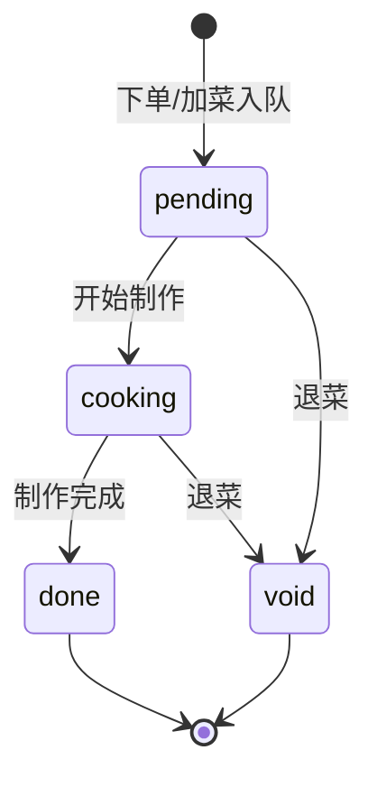

# 独立 KDS 厨房显示模块 — 功能需求文档

> **版本**：2.0（2026-05-25）  
> **产品基准**：`[KDS 厨房显示系统 PRD 商业版功能规格详解.md](./KDS%20厨房显示系统%20PRD%20商业版功能规格详解.md)`（烧烤店五屏、商用状态机、通信协议）  
> **技术关联**：`docs/db_diancan.sql`、`docs/权限设计.md`、`docs/收银系统升级-架构与接口设计.md`、`docs/openapi.yaml`  
> **开发计划**：见 `**docs/kds_module_development_plan.md`**

---

## 1. 文档目标与范围

### 1.1 目标

对接自研点餐后端，实现 PRD 要求的**后厨无纸化、五屏分流、防漏单、实时出餐、岗位隔离**，并满足：

- **烧烤店默认五屏**：抓串汇总、荤烤、素烤、海鲜/锡纸/特色、总出餐核对；
- 与现有**飞鹅厨房小票**可配置共存（`print_only` / `kds_only` / `both`）；
- **不改** `t_order`、`t_order_detail` 表结构；KDS 状态与整单进度写入**扩展表**；
- 连锁 `**shop_id` / `X-Shop-Id`** 严格隔离。

### 1.2 范围边界


| 在范围                                           | 不在范围（本仓库默认）                                    |
| --------------------------------------------- | ---------------------------------------------- |
| 后端：配置、工单、分屏路由、REST、WebSocket、订单埋点、缺货上报、离线批量同步 | 安卓/uni-app 厨显 UI、虚拟列表、语音播报、横屏/息屏（客户端实现，后端提供契约） |
| 抓串汇总 API、整单状态聚合、三端状态回写契约                      | 修改小程序/收银/后台前端页面                                |
| OpenAPI、`init_api_permission.sql` 同步          | 替代飞鹅硬件驱动                                       |


---

## 2. 现状与差距（As-Is）


| 能力   | 现网实现                             | 与 PRD 差距                            |
| ---- | -------------------------------- | ----------------------------------- |
| 接单   | `order_receiving` / `order_rece` | 无 0/1/2 单品制作态、无 10/20/30/40 整单厨显态   |
| 后厨输出 | 飞鹅厨房小票、`cid` 分单打印                | 无屏显、无抓串全店汇总                         |
| 实时通道 | `/ws/menu` 全局广播                  | 无 KDS 分屏订阅、无 `new_order` 等事件        |
| 菜品路由 | `t_order_detail.cid`             | PRD 要求 `**screen_tag`（屏类型）**，需配置层映射 |
| 缺货   | `t_dish.sold_out`、上下架            | 无「厨显上报缺货 → 禁止点餐」闭环 API              |


---

## 3. 术语与 PRD 映射


| PRD 术语          | 后端实现名                            | 说明                                         |
| --------------- | -------------------------------- | ------------------------------------------ |
| 屏幕 / 分屏         | `station`（档口）                    | 表 `t_kds_station`，字段 `screen_tag` 与 PRD 一致 |
| `screen_tag`    | 枚举字符串                            | 见 §4.1，设备绑定后只拉本屏数据                         |
| 单品 / order_item | `ticket`（工单）                     | 表 `t_kds_ticket`，一行 = 明细 × 屏（抓串屏可虚拟聚合展示）   |
| 整单 / order_main | `kds_order` 扩展                   | 表 `t_kds_order`，存厨显整单状态 10/20/30/40/90     |
| `item_id`       | `detail_id`（`t_order_detail.id`） | 接口对外可同时返回 `ticket_id`                      |
| 加急              | `rush_flag`                      | 置顶 + 前端红色（UI 规则不在后端）                       |


### 3.1 五屏标准岗位（`screen_tag` 枚举）


| screen_tag         | 中文名       | 展示与操作范围                           |
| ------------------ | --------- | --------------------------------- |
| `skewer_aggregate` | 抓串汇总屏     | **全店**待做菜品按品名**聚合数量**；不按桌拆；可「已抓齐」 |
| `meat_grill`       | 荤菜烤制屏     | 仅 `screen_tag=meat_grill` 的明细     |
| `veg_grill`        | 素菜烤制屏     | 仅 `veg_grill`                     |
| `seafood_special`  | 海鲜/锡纸/特色屏 | 仅 `seafood_special`               |
| `expedition`       | 总出餐核对屏    | **全屏已完成汇总**（各岗 done 汇总），核对出餐      |


后台可为每个菜品（`t_dish.id`）或分类（`cid`）配置目标 `screen_tag`；未配置走门店 `default_screen_tag` 或「未分配」池。

---

## 4. 状态机（与 PRD 一致，禁止偏离）

### 4.1 单品状态 `item_status`（存 `t_kds_ticket.item_status`）


| 值   | 含义  | PRD      | 后端枚举名     |
| --- | --- | -------- | --------- |
| 0   | 待制作 | 新单未动     | `pending` |
| 1   | 制作中 | 已上炉/开始抓串 | `cooking` |
| 2   | 已完成 | 可出餐      | `done`    |
| 3   | 已退菜 | 不展示、不计出品 | `void`    |





- **抓串屏**：可对聚合行操作「已抓齐」，批量将该品所有 `pending` ticket 置 `cooking` 或写 `t_kds_skewer_pick` 记录，再推送烤制岗。
- **done 后**不可回 `pending`；回退仅 `kds:config` 且记 `t_operation_log`。

### 4.2 整单状态 `order_status`（存 `t_kds_order.kds_order_status`）


| 值   | 含义     | 推导规则                                                            |
| --- | ------ | --------------------------------------------------------------- |
| 10  | 待后厨接单  | 存在任一非 void 且 item_status=0，且尚无 cooking/done                     |
| 20  | 后厨制作中  | 存在 cooking，或 10→首条开始制作                                          |
| 30  | 部分出餐   | 同时存在 done 与 pending/cooking                                     |
| 40  | 整单制作完成 | 全部非 void 明细均为 done                                              |
| 90  | 订单完结   | `transac_status=success` 结账或 `order_receiving=off_order` / 取消归档 |


每次 `item_status` 变更后由 `KdsOrderStatusAggregator` 重算并 WS 广播 `order_status_changed`。

### 4.3 与 legacy 字段映射（可选）


| 配置 `sync_legacy_rece` | 行为                                                                     |
| --------------------- | ---------------------------------------------------------------------- |
| true（建议默认）            | 单品 `done` → `order_rece=rec_order`；整单 40 → `order_receiving=rec_order` |
| false                 | 仅写 KDS 表，不改 `t_order*`                                                 |


### 4.4 UI 颜色规则（前端实现，后端提供字段）


| 条件            | 建议色 | 后端字段                                            |
| ------------- | --- | ----------------------------------------------- |
| item_status=0 | 灰   | `item_status`                                   |
| item_status=1 | 黄   | `item_status`                                   |
| item_status=2 | 绿   | `item_status`                                   |
| 超时未制作         | 红   | `overdue_flag`（`wait_seconds > sla_minutes*60`） |
| 加急            | 红高亮 | `rush_flag=1`                                   |


默认 `sla_minutes=10`（PRD）；门店可配置。

---

## 5. 分屏分流逻辑（烧烤核心）

### 5.1 路由优先级

1. `t_kds_dish_screen`：`dish_id` → `screen_tag`（最优先，对齐 PRD「每菜品绑定 screen_tag」）
2. `t_kds_station_category`：`cid` → `station_id` / `screen_tag`
3. 门店 `default_screen_tag` 或「未分配」告警池

烤制屏（荤/素/海鲜）工单：`ticket` 仅生成在对应 `screen_tag` 的 `station_id`。

### 5.2 抓串汇总屏（`skewer_aggregate`）特殊逻辑


| 规则               | 说明                                                            |
| ---------------- | ------------------------------------------------------------- |
| 数据范围             | **本店当日**所有非 void 且 `item_status in (0,1)` 的明细                 |
| 展示形态             | **按菜品名聚合** `sum(quantity)`，不按桌号拆分                             |
| 不生成 per-table 卡片 | 列表 API 走 `GET /kds/skewer/summary`，与 `GET /kds/order/list` 分离 |
| 已抓齐              | `POST /kds/skewer/picked`：品名 + 可选批量推进关联 ticket → `cooking`    |
| 防漏串              | 聚合结果与明细 `sync` 接口交叉校验（客户端去重）                                  |


### 5.3 总出餐核对屏（`expedition`）

- 拉取各屏 `item_status=2` 的明细，按桌号/取餐号卡片展示；
- 支持「整单核对完成」：`POST /kds/order/complete`（整单 → 40，可选触发 `notice` 取餐）；
- **不可**操作他屏未 done 的菜品（权限校验 `screen_tag`）。

### 5.4 排序规则（全屏通用）

1. `rush_flag DESC`
2. `order_time ASC`（下单越早越靠前）
3. 同单内：辣度优先级（特辣 > 中辣 > 微辣 > 不辣，与厨房小票一致）

---

## 6. 功能需求清单

### 6.1 系统基础（后端支撑）


| ID        | PRD 条款      | 后端需求                                                     |
| --------- | ----------- | -------------------------------------------------------- |
| F-BASE-01 | 设备绑定屏幕类型    | `POST /kds/device/login` 绑定 `screen_tag` + `station_id`  |
| F-BASE-02 | 横屏/息屏/常驻    | 客户端；后端无                                                  |
| F-BASE-03 | 时间 + 今日接单统计 | `GET /kds/stats/today`：`order_count`、`item_count` 按 shop |
| F-BASE-04 | 新单语音播报      | 客户端；WS `new_order` 触发                                    |
| F-BASE-05 | 断线重连、心跳     | WS **15s** ping/pong；`POST /kds/device/heartbeat`        |
| F-BASE-06 | 本地离线缓存      | `POST /kds/sync/all` 批量上报；服务端幂等                          |
| F-BASE-07 | 联网差异同步      | `GET /kds/order/list` + `GET /kds/sync/changes?since=`   |
| F-BASE-08 | 虚拟列表        | 客户端；列表 API 分页 `pageSize≤50`                              |
| F-BASE-09 | 凌晨归档        | 定时任务：已完成 **2 小时**前 `archived=1`（PRD），列表默认过滤              |
| F-BASE-10 | 禁止刷新丢数      | 以 `since` 增量为准，禁止仅全量覆盖无版本                                |


### 6.2 实时订单


| ID       | 需求         | 后端                                         |
| -------- | ---------- | ------------------------------------------ |
| F-ORD-01 | 新下单推送      | WS `new_order`；埋点 `createOrder`            |
| F-ORD-02 | 加菜插入       | WS `update_order`；仅新 `detail_id` 生成 ticket |
| F-ORD-03 | 退菜隐藏       | WS `cancel_item`；`item_status=3`           |
| F-ORD-04 | 改备注刷新      | WS `update_order`；重推该单 payload             |
| F-ORD-05 | 堂食/打包/外卖区分 | 列表返回 `dineInOrTakeOut` + 外卖 `delivery` 摘要  |
| F-ORD-06 | 加急置顶标红     | `rush_flag`；`POST /kds/order/rush`         |
| F-ORD-07 | 排序         | 见 §5.4                                     |


### 6.3 后厨操作（防漏单）


| ID       | PRD 操作     | API                                                           |
| -------- | ---------- | ------------------------------------------------------------- |
| F-OPS-01 | 开始制作       | `POST /kds/item/status` `{ detail_id, status:1, screen_tag }` |
| F-OPS-02 | 制作完成       | 同上 `status:2`                                                 |
| F-OPS-03 | 缺货上报       | `POST /kds/item/lack` → 写日志 + 可选 `sold_out=1`                 |
| F-OPS-04 | 整单全部完成     | `POST /kds/order/finish-all`                                  |
| F-OPS-05 | 已完成下沉      | 列表 `status` 过滤；`include_archived=false`                       |
| F-OPS-06 | 超时 10 分钟预警 | `overdue_flag` 计算字段                                           |


**岗位隔离**：请求体 `screen_tag` 必须与设备绑定一致，且 ticket 所属屏匹配，否则 403。

### 6.4 抓串屏专属


| ID       | 需求     | API                                                |
| -------- | ------ | -------------------------------------------------- |
| F-SKW-01 | 全店待做汇总 | `GET /kds/skewer/summary`                          |
| F-SKW-02 | 显示总串数  | 聚合 `quantity` + `unit`                             |
| F-SKW-03 | 勾选已抓齐  | `POST /kds/skewer/picked`                          |
| F-SKW-04 | 分发至烤制岗 | picked 后将对应明细 ticket 保持/推进，WS 通知烤制屏 `update_order` |
| F-SKW-05 | 高峰备货量  | `GET /kds/skewer/summary?date=` 历史可选 P2            |


### 6.5 数据同步与三端一致


| ID        | 需求             | 实现                                                                               |
| --------- | -------------- | -------------------------------------------------------------------------------- |
| F-SYNC-01 | 状态变更立即 HTTP 回写 | 所有 `POST /kds/item/status` 事务提交后 WS 广播                                           |
| F-SYNC-02 | 同步点餐端/收银端      | 可选 `sync_legacy_rece`；扩展 `GET /admin/order/list` 带出 `kds_order_status`（P2）       |
| F-SYNC-03 | 离线批量           | `POST /kds/sync/all`：`[{detail_id,status,updated_at,client_id}]` 幂等键 `client_id` |
| F-SYNC-04 | 去重             | `t_kds_sync_dedup(client_id)` 唯一                                                 |
| F-SYNC-05 | 归档             | 定时 2h 已完成归档；`POST /kds/archive/clear` 手动清空（设备级，记日志）                              |


### 6.6 异常与健壮性


| ID      | PRD       | 后端                                                 |
| ------- | --------- | -------------------------------------------------- |
| F-EX-01 | WS 15s 心跳 | Spring ping 配置 + 客户端 heartbeat                     |
| F-EX-02 | 断线 3s 重连  | 客户端；服务端无状态连接                                       |
| F-EX-03 | 断网操作缓存    | `sync/all`                                         |
| F-EX-04 | 联网一次性同步   | `sync/all` + `sync/changes`                        |
| F-EX-05 | 重复订单去重    | ticket 唯一 `(detail_id, station_id)`；事件带 `event_id` |
| F-EX-06 | 2h 归档     | 见 F-BASE-09                                        |
| F-EX-07 | 防 DOM 堆积  | 客户端；后端分页 + archived 过滤                             |


### 6.7 权限


| 权限码           | 说明                               |
| ------------- | -------------------------------- |
| `kds:view`    | 只读列表/汇总                          |
| `kds:operate` | 本屏划菜、催菜、抓串 picked（校验 screen_tag） |
| `kds:config`  | 屏/菜品映射、门店模式、设备、重推、缺货策略           |
| `kds:lack`    | 缺货上报（可合并到 operate）               |


设备 token **仅能操作绑定 `screen_tag`**；禁止改价、删单、改历史（接口层不暴露订单写接口）。

### 6.8 配置管理（B 端 `/admin/kds/*`）


| ID       | 功能                                               |
| -------- | ------------------------------------------------ |
| F-CFG-01 | 五屏模板初始化（一键创建 5 个 station）                        |
| F-CFG-02 | 菜品 `screen_tag` 批量绑定（导入 dish_id 列表）              |
| F-CFG-03 | `cid` → `screen_tag` 映射（兼容原 cid 分单）              |
| F-CFG-04 | `kds_mode`：print_only / kds_only / both          |
| F-CFG-05 | `sla_minutes`、`archive_hours`、`sync_legacy_rece` |
| F-CFG-06 | 设备绑定/解绑/心跳监控                                     |


---

## 7. 数据模型（扩展表 v2）

> 脚本：`docs/db_migration_kds.sql`（实现阶段）


| 表                        | 用途                                                                         |
| ------------------------ | -------------------------------------------------------------------------- |
| `t_kds_station`          | 档口/屏；含 `screen_tag`、`shop_id`、`name`、`sort`、`enabled`                      |
| `t_kds_station_category` | cid → station_id                                                           |
| `t_kds_dish_screen`      | dish_id → screen_tag（PRD 菜品绑屏）                                             |
| `t_kds_shop_config`      | kds_mode、sla、archive_hours、sync_legacy_rece、default_screen_tag             |
| `t_kds_device`           | device_code、shop_id、station_id、screen_tag、last_heartbeat                   |
| `t_kds_ticket`           | 工单：detail_id、station_id、screen_tag、item_status(0-3)、rush_flag、时间戳、archived |
| `t_kds_order`            | 整单厨显：order_id、shop_id、kds_order_status(10/20/30/40/90)                     |
| `t_kds_skewer_pick`      | 抓串已抓记录：dish_name、quantity_picked、picked_at（可选）                             |
| `t_kds_sync_dedup`       | client_id 幂等                                                               |
| `t_kds_event_log`        | 可选：WS 事件审计                                                                 |


**ticket 唯一约束**：`(detail_id, station_id)`；抓串屏可不存 ticket 而只聚合查询，或存 `station_id=skewer` 虚拟站 —— **实现采用**：烤制屏存 ticket，抓串屏**仅聚合 API** 读明细，减少冗余。

---

## 8. API 与通信协议（与 PRD 对齐）

### 8.1 路径约定


| PRD 写法                  | 本项目统一路径                     | 说明                                      |
| ----------------------- | --------------------------- | --------------------------------------- |
| `ws://域名/kds/ws`        | `**/ws/kds`**               | 与现有 `/ws/menu` 一致，登记在 `WebSocketConfig` |
| `GET /kds/order/list`   | `**GET /kds/order/list`**   | 参数：`screen_tag`、`status`（单品 0/1/2 或组合）  |
| `POST /kds/item/status` | `**POST /kds/item/status`** | 主操作入口                                   |
| `POST /kds/item/lack`   | `**POST /kds/item/lack`**   |                                         |
| `POST /kds/sync/all`    | `**POST /kds/sync/all`**    |                                         |


**兼容别名**（可选实现）：`/kds/ws` 302 → `/ws/kds`。

### 8.2 WebSocket 事件（下行）


| type                   | 触发                   |
| ---------------------- | -------------------- |
| `new_order`            | 新单入厨显                |
| `update_order`         | 加菜、改备注、状态变更          |
| `cancel_item`          | 退菜 item_status=3     |
| `cancel_order`         | 整单取消                 |
| `order_status_changed` | 整单 10/20/30/40/90 变化 |
| `config_changed`       | 屏映射变更                |


连接：`wss://host/ws/kds?shop_id=&screen_tag=&token=`

服务端按 `(shop_id, screen_tag)` 分桶推送；`expedition` 订阅全屏 done 事件聚合。

### 8.3 REST 补充（本项目扩展）


| 方法       | 路径                      | 说明                |
| -------- | ----------------------- | ----------------- |
| GET      | `/kds/skewer/summary`   | 抓串聚合              |
| POST     | `/kds/skewer/picked`    | 已抓齐               |
| POST     | `/kds/order/rush`       | 加急                |
| POST     | `/kds/order/finish-all` | 整单完成              |
| GET      | `/kds/sync/changes`     | 增量 `since`（毫秒时间戳） |
| GET      | `/kds/stats/today`      | 顶部统计              |
| POST     | `/kds/device/login`     | 设备登录              |
| POST     | `/kds/device/heartbeat` | 心跳                |
| GET/POST | `/admin/kds/`*          | 配置运维              |


### 8.4 列表卡片字段（`GET /kds/order/list` 每条必有）

PRD §4.4：桌号/取餐号、下单时间、等待时长、菜品名、数量+单位、口味备注、单品状态、整单备注；另加 `order_no`、`rush_flag`、`overdue_flag`、`dineInOrTakeOut`、`kds_order_status`。

---

## 9. 与现有后端集成


| 触发点                                      | 动作                                                                    |
| ---------------------------------------- | --------------------------------------------------------------------- |
| `OrderController#createOrder`            | `KdsOrderHook.afterCreate` → tickets + `t_kds_order` + WS `new_order` |
| `OrderController#addDishes`              | 增量 ticket + `update_order`                                            |
| `OrderController#doAutoAcceptAndPrint`   | `kds_mode=both` 并行                                                    |
| 支付成功（打包/外卖）                              | `afterPaid`                                                           |
| `AdminOrderDetailController#delete_menu` | `cancel_item`                                                         |
| 订单取消                                     | `cancel_order`                                                        |
| `t_dish` 维护                              | 后台改菜品时刷新 `t_kds_dish_screen`（可选监听）                                    |


**打印**：`FeieyunController` 不修改；`print_only` 不写 KDS 表。

---

## 10. 非功能需求


| 类别  | 指标                                          |
| --- | ------------------------------------------- |
| 延迟  | WS 推送 P95 < 2s；`item/status` 写库 P95 < 200ms |
| 心跳  | 15s（PRD）                                    |
| 列表  | 单屏待做 < 500 条分页；聚合接口 < 300ms                 |
| 幂等  | `sync/all` 重复提交不重复变更                        |
| 默认  | 未配置门店 `kds_mode=print_only`                 |


---

## 11. 交付验收（对齐 PRD §8）

1. **五屏独立分流**：五类 `screen_tag` 设备互不可见他屏待办（抓串/总出餐除外约定）。
2. **无漏单**：加菜、退菜、断网 `sync/all` 后状态与云端一致。
3. **状态 100% 同步**：单品 0/1/2/3、整单 10/20/30/40 可查询、可 WS 订阅。
4. **抓串汇总准确**：聚合串数与明细 sum 一致。
5. **超时预警**：`overdue_flag` 在 SLA 10 分钟后为 true。
6. **权限**：设备不可跨屏操作、不可改价删单。
7. **兼容现网**：`print_only` 门店行为不变。

---

## 12. PRD 追踪矩阵


| PRD 章节      | 本文档章节                       |
| ----------- | --------------------------- |
| §2 五屏体系     | §3.1、§5                     |
| §3 状态机      | §4                          |
| §4.1～4.9 功能 | §6                          |
| §5 页面结构     | §8.4（字段）；UI 布局前端            |
| §6 接口协议     | §8                          |
| §7 防卡死      | §6.1 F-BASE-08/09、§10；客户端为主 |
| §8 交付标准     | §11                         |


---

## 13. 附录：单品/整单状态与枚举对照

```text
item_status:  0 pending | 1 cooking | 2 done | 3 void
order_status: 10 waiting | 20 cooking | 30 partial | 40 all_done | 90 closed
screen_tag:   skewer_aggregate | meat_grill | veg_grill | seafood_special | expedition
```

legacy：`order_rece` / `order_receiving` 仅在 `sync_legacy_rece=true` 时联动。