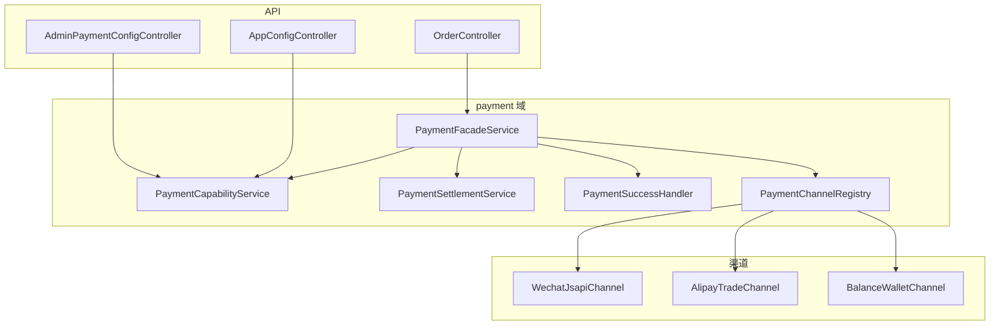

# 线上支付模块 — 技术升级开发方案

> **版本**：1.0（2026-06-03）  
> **范围**：`server/` 后端；REST 变更同步 `openapi.yaml`、`init_api_permission.sql`  
> **约定**：不修改小程序 / 管理端 / 收银前端（除非另行要求）；**保持现有支付相关业务逻辑不变**（券、夜间九折、双商户、充值、回调幂等、退款、支付成功后副作用等）  
> **现状基线**：支付逻辑集中在 `OrderController`；微信 V3 JSAPI + `application.yml` 双商户；线下收款 `PayOfflineCollectController`；余额支付同 Controller；`OrderPayChannelAmounts` 已预留 `pay_amount_alipay`

---

## 0. 工作进度记录（持续更新）


| 日期         | 阶段     | 状态    | 说明                                                                            | OpenAPI     |
| ---------- | ------ | ----- | ----------------------------------------------------------------------------- | ----------- |
| 2026-06-03 | **P0** | ✅ 已完成 | `db_migration_payment_module.sql`、`patch_payment_api_permission.sql`          | —           |
| 2026-06-03 | **P1** | ✅ 已完成 | `com.lanf.payment`、能力/商户 API、40201/40202 拦截                                   | **v1.2.94** |
| 2026-06-03 | **P2** | ✅ 已完成 | Facade 全入口；微信 JSAPI/回调/结算/支付后副作用迁入 `com.lanf.payment`；`payment.use-facade` 回滚 | **v1.2.99** |
| —          | **P3** | ⬜ 待开始 | 支付宝官方支付（依赖前端形态）                                                               | —           |
| —          | **P4** | ⬜ 待开始 | 统一 createPayment、对账流水（可选）                                                     | —           |


**部署前置**：执行 `docs/db_migration_payment_module.sql`、`docs/patch_payment_api_permission.sql`；RBAC 授予 `payment:config:read` / `payment:config:write`。

---

## 1. 背景与目标

### 1.1 现状问题


| 问题                            | 影响                            |
| ----------------------------- | ----------------------------- |
| 支付逻辑与订单 Controller 耦合         | 难扩展渠道、难单测、变更风险大               |
| 微信/支付宝商户参数在 `application.yml` | 改配置需发版；连锁多店难维护                |
| 无「线上支付总开关」                    | 运营无法一键切「联系服务员结账」              |
| 无支付宝官方在线支付                    | 仅有线下个人收款码                     |
| `t_payment` 未在 C 端支付成功时写入     | 对账依赖 `t_order` 渠道列（可接受，二期可增强） |


### 1.2 升级目标

1. **多渠道**：微信支付（迁移）、支付宝支付（新增）、余额支付（迁移）、线下展示收款码（整合能力模型）。
2. **运营可配**：DB 存储商户配置；后台维护渠道开关与关闭文案。
3. **线上可关**：`online_pay_enabled=false` 时，C 端支付接口拒绝并返回统一文案（默认：「请联系服务员结账」）；小程序通过 `GET /config/payment-capabilities` 前置展示。
4. **业务不变**：结算规则、九折仅微信、用券禁余额、双商户路由、充值 `RCH`、换单、`runPostPaymentSuccessSideEffects`、退款语义与现网一致。

### 1.3 非目标（本期）

- 个人收款码与订单自动对账（不根据线下扫码改 `transac_status`）。
- 改造收银台现金结账主流程（`CashierOrderController` 保持独立）。
- 强制废弃现有 URL（`/order/getPrepayId` 等保留，内部委托）。

---

## 2. 目标架构

### 2.1 模块划分

```
server/src/main/java/com/lanf/
├── payment/
│   ├── channel/
│   │   ├── PaymentChannel.java              # 渠道接口
│   │   ├── WechatJsapiChannel.java
│   │   ├── AlipayTradeChannel.java          # P3
│   │   ├── BalanceWalletChannel.java
│   │   └── OfflineCollectCapability.java    # 仅能力查询，不发起支付
│   ├── config/
│   │   ├── PaymentMerchantConfig.java       # 实体
│   │   ├── PaymentCapability.java           # 实体
│   │   ├── PaymentConfigLoader.java         # DB → 内存缓存
│   │   ├── PaymentConfigSync.java           # 启动加载 + 热更新
│   │   └── PaymentCredentialCipher.java     # 密钥加解密
│   ├── settlement/
│   │   ├── PaymentSettlementService.java    # 从 OrderController 迁移 settle*
│   │   └── PayableAmountContext.java
│   ├── notify/
│   │   ├── PaymentNotifyDispatcher.java
│   │   └── WechatNotifyHandler.java
│   ├── success/
│   │   └── PaymentSuccessHandler.java       # runPostPaymentSuccessSideEffects
│   ├── recharge/
│   │   └── MemberRechargePaymentService.java
│   ├── facade/
│   │   └── PaymentFacadeService.java        # 统一入口
│   └── controller/
│       ├── PaymentNotifyController.java     # 可选：从 OrderController 拆回调
│       └── admin/AdminPaymentConfigController.java
├── controller/
│   └── OrderController.java                 # 变薄：委托 PaymentFacade
└── controller/
    └── PayOfflineCollectController.java     # 保留；capabilities 引用其 API
```

### 2.2 核心依赖关系




### 2.3 与现有组件关系


| 现有                                                 | 升级后                                     |
| -------------------------------------------------- | --------------------------------------- |
| `WeChatPrepayNineFoldSettings` + `t_system_config` | **不迁移**；结算服务注入使用，规则不变                   |
| `executeWxJsapiPrepay`                             | `WechatJsapiChannel.createPrepay`       |
| `handlePaymentNotify`                              | `PaymentNotifyDispatcher` → 微信 Handler  |
| `payByBalance`                                     | `BalanceWalletChannel.pay`              |
| `memberRechargeWechat`                             | `MemberRechargePaymentService` + Facade |
| `OrderController.refund`                           | `PaymentFacadeService.refund`（微信/余额分发）  |
| `PayOfflineCollectController`                      | 不变；`PaymentCapabilityService` 聚合线下能力    |


---

## 3. 数据模型

### 3.1 新建表：`t_payment_merchant_config`

按 **门店 + 渠道 + 商户实例** 存储；支持连锁默认模板与单店覆盖。


| 字段                          | 类型           | 说明                                                           |
| --------------------------- | ------------ | ------------------------------------------------------------ |
| `id`                        | BIGINT PK    |                                                              |
| `shop_id`                   | INT          | `0`=全门店默认，`>0`= `t_shop.id`                                  |
| `channel`                   | VARCHAR(16)  | `wechat` / `alipay`                                          |
| `merchant_key`              | VARCHAR(32)  | 实例键：`default`（现 merchantId=1）、`small_amount`（现 merchantId=2） |
| `enabled`                   | TINYINT      | 是否启用                                                         |
| `app_id`                    | VARCHAR(64)  | 小程序 AppId                                                    |
| `mch_id`                    | VARCHAR(32)  | 微信商户号 / 支付宝 PID                                              |
| `notify_url`                | VARCHAR(512) | 支付回调（可由系统生成，运营只读）                                            |
| `refund_notify_url`         | VARCHAR(512) | 退款回调                                                         |
| `api_v3_key_enc`            | VARCHAR(512) | 微信 APIv3 密钥（AES 密文）                                          |
| `serial_no`                 | VARCHAR(64)  | 微信证书序列号                                                      |
| `platform_pub_key_id`       | VARCHAR(128) | 微信 `Wechatpay-Serial` 对应公钥 ID                                |
| `private_key_ref`           | VARCHAR(512) | 商户私钥：密文 PEM 或服务器路径                                           |
| `alipay_app_cert_ref` 等     | VARCHAR(512) | 支付宝证书三元组引用（P3）                                               |
| `routing_rule_json`         | JSON         | 路由规则，见 3.3                                                   |
| `sort_order`                | INT          | 列表排序                                                         |
| `remark`                    | VARCHAR(255) |                                                              |
| `created_at` / `updated_at` | DATETIME     |                                                              |


**唯一索引**：`uk_shop_channel_key (shop_id, channel, merchant_key)`。

### 3.2 新建表：`t_payment_capability`


| 字段                         | 类型           | 说明                          |
| -------------------------- | ------------ | --------------------------- |
| `id`                       | BIGINT PK    |                             |
| `shop_id`                  | INT          | `0`=默认                      |
| `online_pay_enabled`       | TINYINT      | **线上支付总开关**（含微信/支付宝/余额线上扣款） |
| `wechat_enabled`           | TINYINT      | 微信 JSAPI                    |
| `alipay_enabled`           | TINYINT      | 支付宝（P3）                     |
| `balance_enabled`          | TINYINT      | 余额支付                        |
| `offline_collect_enabled`  | TINYINT      | 是否展示线下收款码                   |
| `offline_collect_channels` | VARCHAR(32)  | `wechat,alipay` 逗号分隔        |
| `disabled_message`         | VARCHAR(255) | 关闭线上时文案，默认「请联系服务员结账」        |
| `updated_at`               | DATETIME     |                             |


**唯一索引**：`uk_shop (shop_id)`。

**继承规则**：查询 `shop_id=N` 时，各字段若 NULL 则回退 `shop_id=0`（与 `ZsqSystemSettings` 一致）。

### 3.3 商户路由规则 JSON（迁移现网）

对应 `OrderController.executeWxJsapiPrepay` 中 `wxzf` + 打包/外卖 + `paidYuan <= 159` → 商户 2：

```json
{
  "type": "amount_and_dining",
  "enabledFlag": "wxzf",
  "diningTypes": ["打包", "外卖"],
  "maxPaidYuan": 159,
  "targetMerchantKey": "small_amount",
  "defaultMerchantKey": "default"
}
```

`enabledFlag` 初期可映射为 `t_system_config` 键 `payment.wxzf_routing_enabled` 或并入 capability 表扩展列；**行为与现网一致**。

### 3.4 配置迁移


| 来源                              | 目标                                                      |
| ------------------------------- | ------------------------------------------------------- |
| `application.yml` → `weixin.`*  | `shop_id=0, channel=wechat, merchant_key=default`       |
| `application.yml` → `weixin2.`* | `shop_id=0, channel=wechat, merchant_key=small_amount`  |
| 默认能力                            | `online_pay_enabled=1`，各渠道 `=1`，`disabled_message` 默认文案 |


**双读期**：`PaymentConfigLoader` 优先 DB；缺失字段 fallback `application.yml`（P2 结束后可文档标注废弃 yml 商户段）。

### 3.5 密钥安全


| 项    | 要求                                                         |
| ---- | ---------------------------------------------------------- |
| 主密钥  | 环境变量 `PAYMENT_CONFIG_MASTER_KEY`，不入库、不进 Git                |
| 存储   | `api_v3_key_enc`、`private_key_ref` 加密或路径引用                 |
| 后台展示 | 脱敏（仅后四位）；未改字段传 `*`***** 跳过更新                               |
| 日志   | 禁止打印明文密钥与完整 PEM                                            |
| 权限   | `admin:payment:config:read` / `admin:payment:config:write` |


---

## 4. 支付渠道设计

### 4.1 微信支付（P1～P2）


| 项    | 说明                                                                                                 |
| ---- | -------------------------------------------------------------------------------------------------- |
| API  | 保持 `POST /v3/pay/transactions/jsapi`                                                               |
| C 端  | 保持 `POST /order/getPrepayId` 请求/响应                                                                 |
| 回调   | 保持 `POST /order/pay/notify`（`@NoAuth`，微信签名校验）                                                      |
| 退款   | 保持 `OrderController.refund` 对外签名；内部调微信 V3                                                          |
| 退款回调 | 保持 `POST /order/refund/notify`（`OrderRefundController`）                                            |
| 成功写单 | `transac_status=success`、`payment_method=微信支付`、`OrderPayChannelAmounts.applySingleChannel(wechat)` |


### 4.2 支付宝支付（P3）


| 项    | 说明                                                                               |
| ---- | -------------------------------------------------------------------------------- |
| 前置条件 | 与产品确认 C 端形态：支付宝小程序 `my.tradePay` / H5 / 仅线下码                                     |
| 建议接口 | `POST /order/getAlipayTradeNo` 或统一 `POST /order/createPayment`（`channel=alipay`） |
| 回调   | `POST /order/pay/alipay/notify`（新增，鉴权方式按支付宝规范）                                   |
| 结算   | 复用 `PaymentSettlementService`；**九折不叠加**（与现网「仅微信享九折」一致）                           |
| 成功写单 | `payment_method=支付宝支付`、`pay_amount_alipay`                                       |


### 4.3 余额支付（P1）


| 项   | 说明                                               |
| --- | ------------------------------------------------ |
| API | 保持 `POST /order/payByBalance`                    |
| 限制  | 用券禁余额；九折 eligible 禁余额；`BAL_` 占位 `transaction_id` |
| 开关  | `balance_enabled`；总关 `online_pay_enabled` 时一并拒绝  |
| 成功  | `PaymentSuccessHandler` 与微信共用                    |


### 4.4 线下收款码（整合 P1）


| 项   | 说明                                                                        |
| --- | ------------------------------------------------------------------------- |
| API | 保持 `POST /pay/offline-collect/temp-qrcode`、`GET .../jump`                 |
| 运营  | 保持 `POST /admin/shop/offline-collect/upload` → `t_shop.offline_collect_`* |
| 能力  | `offline_collect_enabled` + `offline_collect_channels`                    |
| 行为  | **不**根据扫码自动改订单支付状态（与现网一致）                                                 |


### 4.5 会员微信充值（P2）


| 项     | 说明                                                     |
| ----- | ------------------------------------------------------ |
| 创建    | `POST /order/recharge` → `t_member_recharge`，单号 `RCH`* |
| 支付    | 共用 `executeWxJsapiPrepay` 逻辑；总关时拒绝                     |
| 回调    | `handleWechatMemberRechargePaymentNotify` 分支保留         |
| 支付宝充值 | P3 可选扩展 `channel=alipay`                               |


---

## 5. API 设计

### 5.1 C 端（兼容 + 新增）

#### 5.1.1 保留路径（实现委托 `PaymentFacadeService`）


| 方法   | 路径                                 | 说明        |
| ---- | ---------------------------------- | --------- |
| POST | `/order/getPrepayId`               | 微信 prepay |
| POST | `/order/payByBalance`              | 余额支付      |
| POST | `/order/recharge`                  | 微信充值创单+下单 |
| POST | `/order/pay/notify`                | 微信支付回调    |
| POST | `/order/refund/notify`             | 微信退款回调    |
| POST | `/pay/offline-collect/temp-qrcode` | 线下码 PNG   |


#### 5.1.2 新增

`**GET /config/payment-capabilities`**

- Header：`X-Shop-Id`（与连锁一致）
- Response 示例：

```json
{
  "code": 0,
  "onlinePayEnabled": true,
  "disabledMessage": "请联系服务员结账",
  "channels": {
    "wechat": { "enabled": true },
    "alipay": { "enabled": false },
    "balance": { "enabled": true },
    "offlineCollect": {
      "enabled": true,
      "modes": ["wechat", "alipay"],
      "tempQrcodeApi": "/pay/offline-collect/temp-qrcode"
    }
  },
  "nineFold": { }
}
```

`nineFold` 可嵌套现有 `WeChatPrepayNineFoldSettings.toPublicMap()`，减少小程序请求次数。

#### 5.1.3 线上关闭错误码


| code    | HTTP | 场景                                                                  |
| ------- | ---- | ------------------------------------------------------------------- |
| `40201` | 200  | `online_pay_enabled=false`，拒绝 getPrepayId / payByBalance / recharge |
| `40202` | 200  | 单渠道关闭（如仅关微信）                                                        |
| `msg`   |      | 取 `disabled_message`                                                |


小程序：**进入支付页先拉 capabilities**；`onlinePayEnabled=false` 时隐藏支付按钮，展示 `disabledMessage`；若 `offlineCollect.enabled` 则展示收款码区域。

#### 5.1.4 可选统一入口（P4）

```
POST /order/createPayment
Body: { orderNo, openid, channel: "wechat|alipay", coupon_id?, code? }
Response: 与 getPrepayId 或支付宝调起参数对称
```

### 5.2 B 端（新增 `AdminPaymentConfigController`）

前缀建议：`/admin/payment`；鉴权 JWT + 权限码；Header `X-Shop-Id` 表示编辑目标门店（`0` 为模板）。


| 方法     | 路径                | 权限                           | 说明                    |
| ------ | ----------------- | ---------------------------- | --------------------- |
| GET    | `/capabilities`   | `admin:payment:config:read`  | 查询能力（含继承）             |
| PUT    | `/capabilities`   | `admin:payment:config:write` | 更新开关与文案               |
| GET    | `/merchants`      | read                         | 商户列表（脱敏）              |
| GET    | `/merchants/{id}` | read                         | 单条详情                  |
| POST   | `/merchants`      | write                        | 新增商户实例                |
| PUT    | `/merchants/{id}` | write                        | 更新                    |
| DELETE | `/merchants/{id}` | write                        | 禁用/删除（建议软删 enabled=0） |
| GET    | `/notify-urls`    | read                         | 系统回调 URL 模板（只读）       |
| POST   | `/merchants/test` | write                        | 可选：密钥探活               |


保存后调用 `PaymentConfigCache.invalidate(shopId)`，**无需重启**。

### 5.3 OpenAPI 与权限

- 每个新/改接口同步 `server/docs/openapi.yaml`，递增 `info.version`，在 `info.description` 顶部追加变更摘要。
- 新增 `server/docs/patch_payment_api_permission.sql` 或在 `init_api_permission.sql` 追加段。

---

## 6. 核心业务逻辑保持不变清单

以下逻辑迁入 `PaymentSettlementService` / `PaymentSuccessHandler` 后 **禁止改语义**（须单测锁定）：


| 编号  | 逻辑                                                   | 现网位置                                    |
| --- | ---------------------------------------------------- | --------------------------------------- |
| L1  | 订单 `unsettled` 才可支付；已 `success` 拒绝                   | getPrepayId / payByBalance              |
| L2  | 优惠券校验、写 `discount_amount`、占用与失败回退                    | settleOrderPayableAmounts               |
| L3  | 夜间九折：开关、时段、最低金额、就餐方式；**仅 allowNineFold=true**        | WeChatPrepayNineFoldSettings            |
| L4  | 用券不叠九折；用券不可余额支付                                      | settle / payByBalance                   |
| L5  | 九折 eligible 不可余额支付                                   | payByBalance                            |
| L6  | 双商户：外卖/打包 + ≤159 元 → merchant 2（wxzf）                | executeWxJsapiPrepay                    |
| L7  | 微信重入参数不一致 → 换 order_no / 充值单号                        | executeWxJsapiPrepay                    |
| L8  | 回调幂等：notifyId 缓存 + 订单锁                               | handlePaymentNotify                     |
| L9  | 支付成功：核销券、积分、桌台、打印、KDS、外卖 markPaid、邀请首单返利             | runPostPaymentSuccessSideEffects        |
| L10 | 充值 RCH：不入 t_order；回调入账 balance+赠送金                   | handleWechatMemberRechargePaymentNotify |
| L11 | 余额扣款本金/赠送金拆分；退款 BAL_ 本地退回                            | payByBalance / refund                   |
| L12 | 微信退款 + refund_amount 累加；不改 transac_status 为 refunded | refund / refund notify                  |


---

## 7. 实施分期

### 7.1 阶段总览


| 阶段     | 名称            | 工期（1 人全职后端） | 交付物                                         |
| ------ | ------------- | ----------- | ------------------------------------------- |
| **P0** | 设计固化与 DDL     | 3～4 天       | 本文评审、`db_migration_payment_module.sql`、权限草案 |
| **P1** | 骨架 + 配置 + 总开关 | 8～10 天      | payment 包、DB 配置加载、capabilities API、总开关拦截    |
| **P2** | 微信迁出 + 回调     | 8～10 天      | Facade 委托、结算/成功 Handler 迁出、回归通过             |
| **P3** | 支付宝           | 12～15 天     | 支付宝渠道 + 回调 + 开关（依赖前端联调）                     |
| **P4** | 增强（可选）        | 5～7 天       | createPayment 统一入口、t_payment 流水、对账 API      |


**合计**：约 **5～7 周**（P3 视支付宝前端形态浮动）。

### 7.2 P0 — 设计固化与 DDL

**任务**

- 评审支付宝 C 端方案（**P3 前与产品确认**）。
- 编写 `docs/db_migration_payment_module.sql`（两表 + 种子数据从 yml 导入）。
- 编写 `docs/patch_payment_api_permission.sql`。
- 更新本文 §0 进度表。

**验收**

- DDL 在测试库可重复执行；种子后微信下单仍可用 yml fallback。

### 7.3 P1 — 骨架、配置库化、总开关

**任务**

- 创建 `com.lanf.payment` 包与核心服务。
- 实现 `PaymentMerchantConfigService`、`PaymentCapabilityService`、`PaymentConfigSync`（DB 优先 + yml fallback）。
- 实现 `PaymentCredentialCipher`（加解密工具）。
- `AdminPaymentConfigController` CRUD（脱敏）。
- `GET /config/payment-capabilities`（`AppConfigController`）。
- `PaymentOnlineGuardService` 在 getPrepayId / payByBalance / recharge **入口**检查能力开关。
- 从 `OrderController` **复制** 结算逻辑至 `PaymentSettlementService`（**P2**）。

**验收**

- 后台关闭线上支付后，三接口返回 `40201` + 配置文案；capabilities 同步为 false。
- 开启状态下 getPrepayId 与现网响应一致（对比测试）。

### 7.4 P2 — 微信迁出

**任务**

- ✅ `WechatJsapiChannel`（从 `executeWxJsapiPrepay` 迁移，2026-06-03）。
- ✅ `WechatPaymentNotifyHandler`、`WechatMemberRechargeNotifyHandler`（从 `handlePaymentNotify` 迁移）。
- ⬜ `PaymentNotifyDispatcher`（可选，当前由 `WechatPaymentNotifyService` 直调 Handler）。
- ✅ `PaymentSettlementService.fillPayableAmountContext` / `settle`（2026-06-03）。
- ✅ `PaymentSuccessHandler`（2026-06-03；自动接单/打印内容仍 Bridge → OC）。
- ✅ `PaymentFacadeService.memberRechargeWechat`（2026-06-03）。
- ⬜ `BalanceWalletChannel`（可选抽象；余额逻辑已在 Facade）。
- `OrderController` 支付入口已委托 Facade；**strangler** 保留 `use-facade=false` 时 OC 内 prepay/notify 原路径。
- 配置 feature flag：`payment.use-facade=true`（默认 true；置 false 回滚）。
- 冒烟：`server/scripts/payment_smoke_test.py`；完整回归 §9 人工/沙箱。

**验收**

- 灰度开关 true/false 对比测试通过。
- 回归矩阵 §9 全绿。

### 7.5 P3 — 支付宝

**任务**

- `AlipayTradeChannel`（下单、验签、退款）。
- `POST /order/pay/alipay/notify`。
- `alipay_enabled` 与 capabilities 透出。
- OpenAPI、Postman 示例。

**验收**

- 沙箱端到端：下单 → 回调 → `pay_amount_alipay` → 退款。

### 7.6 P4 — 增强（可选）

- `POST /order/createPayment`。
- 支付成功写 `t_payment`。
- `GET /admin/daily/byChannel` 与渠道列对齐校验。

---

## 8. 代码迁移对照表


| 原方法（OrderController）                        | 目标类                                            | 备注           |
| ------------------------------------------- | ---------------------------------------------- | ------------ |
| `settleOrderPayableAmounts`                 | `PaymentSettlementService`                     | ✅ 2026-06-03 |
| `fillPayableAmountContext`                  | 同上                                             | ✅ 2026-06-03 |
| `executeWxJsapiPrepay`                      | `WechatJsapiChannel`                           | ✅ 2026-06-03 |
| `getPrepayId` / `payByBalance` / `recharge` | `PaymentFacadeService`                         | ✅ 2026-06-03 |
| `handlePaymentNotify`                       | `WechatPaymentNotifyHandler`                   | ✅ 2026-06-03 |
| `handleWechatMemberRechargePaymentNotify`   | `WechatMemberRechargeNotifyHandler`            | ✅ 2026-06-03 |
| `runPostPaymentSuccessSideEffects`          | `PaymentSuccessHandler`                        | ✅ 2026-06-03 |
| `generatePaymentSignature` 等                | `WechatPayV3Crypto` / `WechatMerchantKeyStore` | ✅ 2026-06-03 |
| `refund`                                    | 仍 `OrderController.refund`（P4 可选）              | ⬜ 未迁         |


---

## 9. 测试与回归矩阵


| #   | 场景                     | 预期                                            |
| --- | ---------------------- | --------------------------------------------- |
| T1  | `online_pay_enabled=0` | getPrepayId / payByBalance / recharge → 40201 |
| T2  | capabilities           | 与开关一致；文案正确                                    |
| T3  | 仅关微信                   | 40202；余额/线下按配置                                |
| T4  | 用券 + 微信 prepay         | 金额=券后；无九折                                     |
| T5  | 无券 + 九折时段 + 微信         | 实付=券后×payRate；写 discount_amount               |
| T6  | 九折 eligible + 余额       | 拒绝                                            |
| T7  | 用券 + 余额                | 拒绝                                            |
| T8  | 外卖 ≤159 + wxzf         | merchant_key=small_amount                     |
| T9  | 微信重入不一致                | newOrderNo                                    |
| T10 | 支付回调重复                 | 不重复积分/打印                                      |
| T11 | 充值 RCH 成功              | balance 入账；无 order 副作用                        |
| T12 | 微信退款                   | refund_amount 累加                              |
| T13 | 余额退款 BAL_              | 退回钱包                                          |
| T14 | shop_id=2 无配置          | 继承 shop_id=0                                  |
| T15 | 线下码                    | 总关线上仍可展示（若 offline 开）                         |


**自动化建议**

- 扩展 `WeChatPrepayNineFoldSettingsTest` 风格覆盖 `PaymentSettlementService`。
- 脚本：`server/scripts/payment_smoke_test.py`（capabilities + getPrepayId 探活）。

---

## 10. 部署与运维

### 10.1 配置项


| 环境变量                        | 说明             |
| --------------------------- | -------------- |
| `PAYMENT_CONFIG_MASTER_KEY` | 商户密钥加解密主密钥     |
| `app.public-base-url`       | 线下 jumpUrl（已有） |


### 10.2 发布顺序

1. 执行 DDL + 种子（商户从 yml 导入）。
2. 发版后端（`payment.use-facade=false`）。
3. 运营后台配置校验、探活。
4. 灰度 `payment.use-facade=true`。
5. P3 支付宝需在开放平台配置新 notify URL。

### 10.3 回滚

- Facade 开关置 false → 立即回到 OrderController 原路径（P2 前保留原方法体或 git tag）。
- 能力总开关：紧急关闭线上支付无需回滚代码。

---

## 11. 风险与缓解


| 风险                | 缓解                              |
| ----------------- | ------------------------------- |
| 大 Controller 迁移回归 | 双份逻辑短期并存 + feature flag + §9 矩阵 |
| 密钥泄露              | 加密、脱敏、权限、审计日志                   |
| 支付宝在微信内受限         | 产品先定形态；一期可仅开线下支付宝码              |
| 连锁配置错误            | 默认模板 + 后台「从模板复制」+ test 接口       |
| DB 与 yml 不一致      | 双读期；文档标明 yml 废弃时间表              |


---

## 12. 交付物清单


| 文档/代码   | 路径                                                |
| ------- | ------------------------------------------------- |
| 本开发方案   | `docs/payment_module_upgrade_development_plan.md` |
| DDL     | `docs/db_migration_payment_module.sql`（P0）        |
| 权限补丁    | `docs/patch_payment_api_permission.sql`（P0）       |
| 运营说明    | `docs/payment_admin_setup_guide.md`（P1，可选）        |
| 后端实现    | `server/src/main/java/com/lanf/payment/`**        |
| OpenAPI | `docs/openapi.yaml`                               |
| 冒烟脚本    | `server/scripts/payment_smoke_test.py`（P2）        |


---

## 13. 附录：现网关键配置参考

`application.yml` 双商户（迁移后写入 `t_payment_merchant_config`）：

- `weixin.`* → `merchant_key=default`
- `weixin2.`* → `merchant_key=small_amount`
- 共用 `notify-url`：`/order/pay/notify`
- 退款：`/order/refund/notify`

九折配置键（保持 `t_system_config`，不迁入商户表）：

- 见 `WeChatPrepayNineFoldConfigKeys` 与 `PUT /admin/config/wechat-prepay-ninefold`。

---

**文档维护**：每阶段完成更新 §0 进度表与 OpenAPI 版本号。