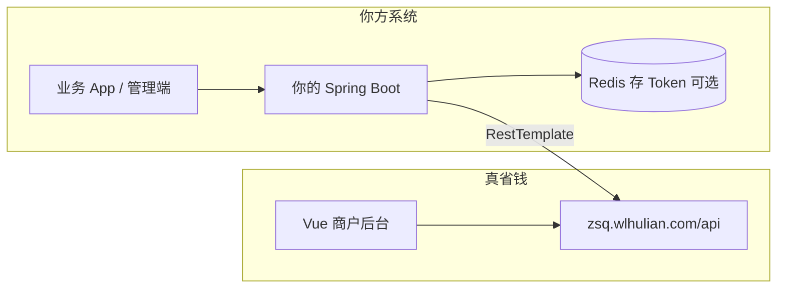
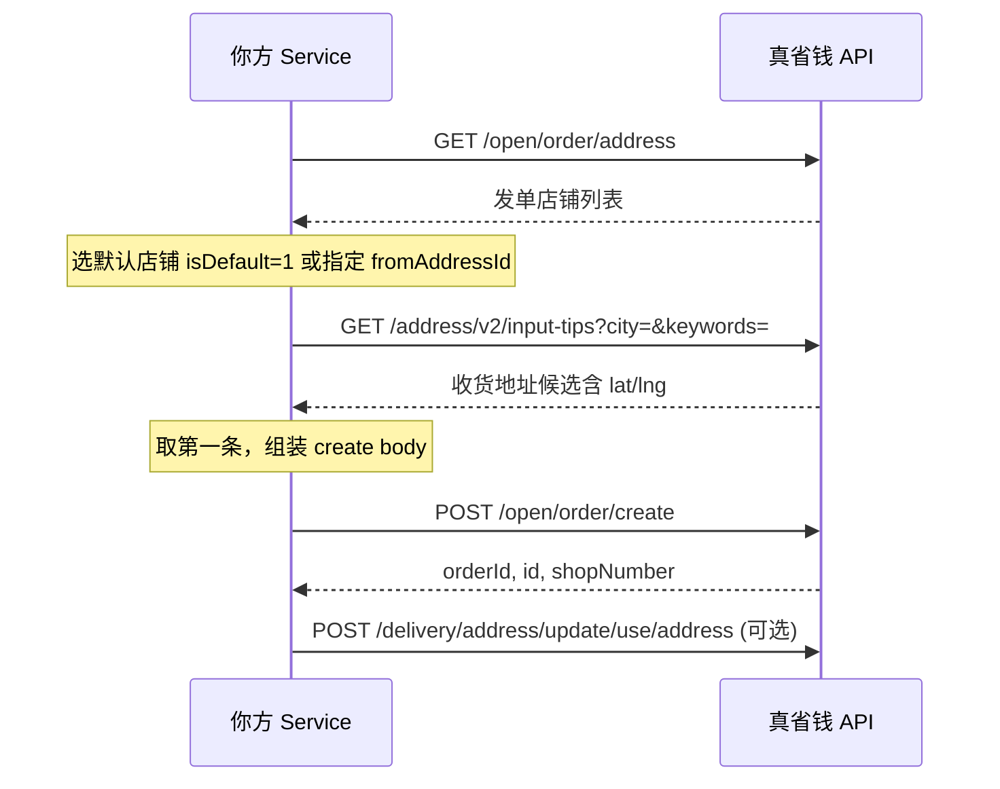
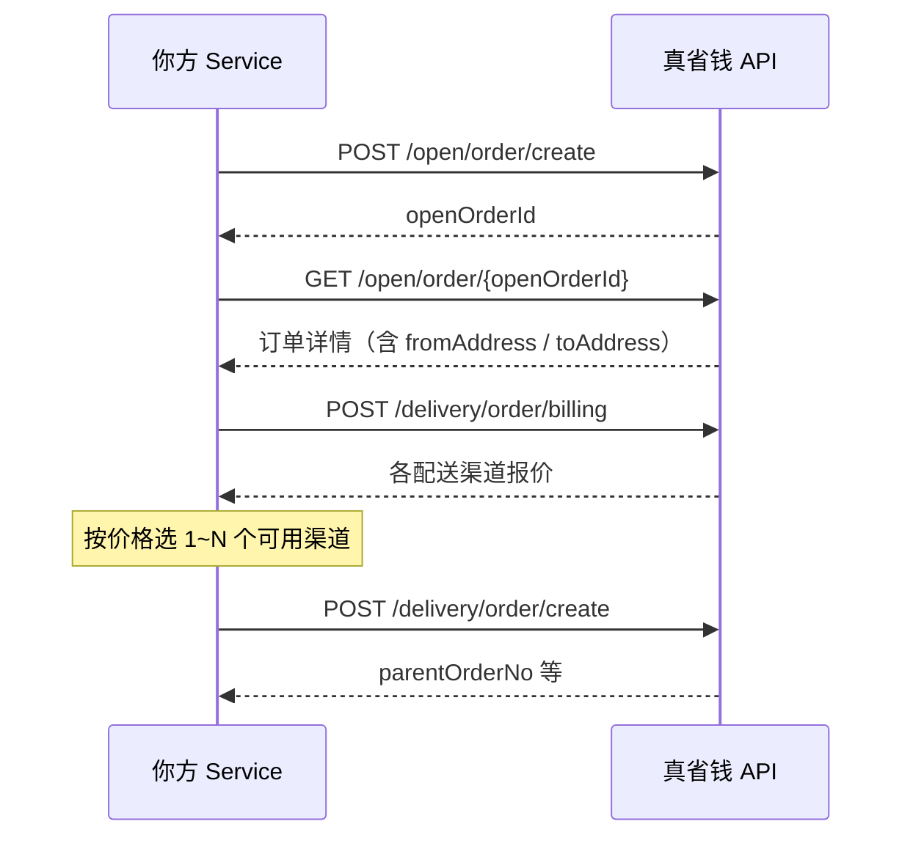

# 真省钱商户后台对接 — 后端开发文档

| 项目 | 说明 |
|------|------|
| 文档版本 | v1.0 |
| 更新日期 | 2026-05-23 |
| 目标读者 | 接手本对接的后端开发、测试、运维 |
| 对接平台 | [真省钱聚合跑腿 · 商户管理后台](https://zsq.wlhulian.com/#/login) |
| 远端 API 基址 | `https://zsq.wlhulian.com/api` |

---

## 1. 项目背景

### 1.1 业务目标

在**不改造真省钱官方后台**的前提下，实现：

1. **自动登录**商户账号，维持会话（Token）。
2. **程序化创建外卖订单**（对应后台「配送管理 → 新建外卖订单」）。
3. 在你方服务器提供 **统一 REST 接口**，供业务系统、定时任务、小程序 BFF 等调用。

### 1.2 当前交付范围（已完成）

| 能力 | Node 脚本 | Java 模块 |
|------|-----------|-----------|
| 密码登录（商户/接口方） | ✅ `npm run login` | ✅ `POST /api/zsq/auth/login` |
| 会话校验 | ✅ `npm run verify` | ✅ `GET /api/zsq/auth/verify` |
| 获取发单店铺 | ✅（下单流程内） | ✅ `GET /api/zsq/orders/shops` |
| 地址解析（高德 tips） | ✅（下单流程内） | ✅ `GET /api/zsq/orders/address/tips` |
| 创建外卖订单 | ✅ `npm run order:create` | ✅ `POST /api/zsq/orders/takeaway` |
| 保存并发单（一键下单） | ✅（探针脚本） | ✅ `POST /api/zsq/orders/takeaway/dispatch` |
| 骑手实时定位与 ETA | ✅（探针脚本） | ✅ `GET /api/zsq/orders/{openOrderId}/tracking` |
| UI 自动化（Playwright） | ✅ 登录/下单 UI 模式 | — |

### 1.3 重要说明

- 真省钱**未提供公开 OpenAPI 文档**，本文档接口来自 **前端 JS 包分析 + 实测抓包**，上线后若官方升级前端，需回归验证。
- 所有写操作（登录、下单）均产生**真实数据**，测试请用测试手机号/地址，避免误发配送。

---

## 2. 仓库结构

```
真省钱/
├── docs/                          # 开发文档（本文档、API 附录）
├── java-backend/                  # Spring Boot 对接模块（合并到你方服务）
│   └── src/main/java/com/zsq/integration/
├── src/                           # Node + Playwright 自动化（联调/回归用）
│   ├── api/                       # HTTP 客户端、订单 API
│   ├── auth/                      # 登录、会话
│   ├── flows/                     # 业务流程
│   ├── pages/                     # 页面 Page Object
│   └── cli.ts                     # 命令行入口
├── storage/                       # 会话文件（gitignore，勿提交）
├── config.example.env             # Node 环境变量模板
├── package.json
└── README.md                      # 快速上手（运维/脚本）
```

**后端接手建议**：以 `java-backend` 为主开发；`src/` 用于对照联调、复现问题、快速验证远端 API 是否变更。

---

## 3. 系统架构



### 3.1 分层职责（Java）

| 层 | 类/包 | 职责 |
|----|--------|------|
| Controller | `web.ZsqAuthController` `web.ZsqOrderController` | 你方对外 REST，入参校验 |
| Service | `service.ZsqAuthService` `service.ZsqOrderService` | 业务编排：选店、地理编码、组装下单 body |
| Remote | `remote.ZsqRemoteClient` | 仅 HTTP 调用真省钱，不含业务规则 |
| Config | `config.ZsqProperties` | `zsq.*` 配置项 |

### 3.2 请求头约定（调用真省钱）

每次请求真省钱 API 需带：

| Header | 值 | 必填 |
|--------|-----|------|
| `Authorization` | 登录返回的完整字符串，一般为 `Bearer eyJ...` | 除登录外必填 |
| `requestType` | `pc` | 是 |
| `Content-Type` | `application/json` | POST 时 |

Cookie 名（浏览器场景）：`open_admin_login_token`，与 `Authorization` 值一致；Java 侧**推荐只用 Header**。

---

## 4. 认证与登录

### 4.1 登录类型

| 角色 | `type` 字段 | 登录路径 |
|------|-------------|----------|
| 商户（默认） | `2` | `POST /store/staff/login` |
| 接口方 | `1` | `POST /pt/app/login` |

| 方式 | `loginType` | 说明 |
|------|-------------|------|
| 密码 | `1` | `password` 必填 |
| 短信验证码 | `2` | `code` 必填，`password` 传空 |

### 4.2 登录请求体（真省钱）

```json
{
  "username": "手机号",
  "password": "密码",
  "type": 2,
  "loginType": 1,
  "code": ""
}
```

### 4.3 登录成功响应（真省钱）

```json
{
  "code": 200,
  "message": "操作成功",
  "data": {
    "token": "eyJhbGci...",
    "tokenHead": "Bearer "
  }
}
```

**组装 Token**：`authorization = tokenHead + token`（Java：`ZsqLoginTokenData.fullAuthorization()`）。

### 4.4 失败示例

```json
{
  "code": 500,
  "message": "用户名或密码错误",
  "traceId": "dfa44527...",
  "data": null
}
```

### 4.5 你方接口：登录

见 [API 文档 - 认证](./API.md#认证)。

**后续开发建议**：

- 将 `authorization` 与你们 `userId` 绑定存入 Redis，TTL 参考 JWT `exp`（约 7 天，以实际 token 为准）。
- 提供刷新机制：token 失效时重新调用登录或返回 401 由客户端重新授权。
- **禁止**把真省钱密码下发到前端。

---

## 5. 创建外卖订单（核心流程）

### 5.1 后台页面对应关系

| 后台路由 | 页面标题 |
|----------|----------|
| `#/delivery/createWindowOrder` | 新建外卖订单 |
| `#/delivery/takeawayOrder` | 外卖订单列表（含「创建订单」入口） |

### 5.2 业务流程（API 模式，与 Java/Node 一致）



### 5.3 发单店铺列表

**请求**：`GET /open/order/address`  
**响应 `data`**：数组，字段要点：

| 字段 | 类型 | 说明 |
|------|------|------|
| `id` | number | 发单店铺 ID → `fromAddressId` |
| `shopName` | string | 店铺名 |
| `isDefault` | 0/1 | 1=默认店铺 |
| `industryType` | number | 行业类型 → `goodType` |
| `cityName` | string | 城市 |
| `shopLat` / `shopLng` | string | 店铺坐标 |

### 5.4 地址解析

**请求**：`GET /address/v2/input-tips?city={城市}&keywords={关键词}`  

- `city` 示例：`江门市`（需 URL 编码）
- `keywords` 示例：`沙坪街道大鹏路`

**响应**：JSON 数组（注意：不是 `{code,data}` 包装时也为 200 包装在标准 `ZsqApiResponse` 里，`data` 为数组）。

单条结构：

| 字段 | 说明 |
|------|------|
| `address` | 完整地址文案 → `toAddress` |
| `location.lat` / `location.lng` | 收货坐标（必填） |
| `name` | POI 名称 |

> `/address/get/suggestion` 实测返回 500，**请使用 v2 input-tips**。

### 5.5 创建订单

**请求**：`POST /open/order/create`

| 字段 | 类型 | 必填 | 说明 |
|------|------|------|------|
| `type` | int | **是** | 固定 `1`（缺失会报 `typemust not be null`） |
| `fromAddressId` | long | 是 | 发单店铺 id |
| `toReceiverName` | string | 是 | 收货人 |
| `toMobile` | string | 是 | 手机号；分机号格式 `手机号_分机` |
| `toAddress` | string | 是 | 收货地址（解析结果） |
| `toAddressDetail` | string | 是 | 门牌号 |
| `toLatitude` | string | 是 | 纬度 |
| `toLongitude` | string | 是 | 经度 |
| `goodType` | int | 是 | 一般取店铺 `industryType` |
| `productName` | string | 是 | 默认「到店查看」 |
| `productAmount` | string | 是 | 金额（元，字符串） |
| `productCount` | int | 是 | 数量 |
| `weight` | int | 是 | 重量 kg，默认 3 |
| `orderRemark` | string | 否 | 备注 |
| `expectTime` | string | 否 | 空=立即送达；有值则 `orderType=2` |
| `orderType` | int | 是 | 无预约 `1`，有预约 `2` |

**成功响应 `data`**：

```json
{
  "shopNumber": "3",
  "id": 43787770,
  "orderId": "808353241436549"
}
```

- `orderId`：业务订单号（对外展示推荐用这个）
- `id`：内部主键

### 5.6 保存并发单（一键下单）

后台「保存并发单」在创建成功后会自动：**询价 → 选渠道 → 发起配送**。



**billing 请求体要点**（实测）：

| 字段 | 说明 |
|------|------|
| `deliveryShopId` | **字符串**，取详情 `deliveryShopId` 或 `fromAddress.id` |
| `receiverList[].goodType` | **字符串** |
| `receiverList[]` | 地址字段来自详情 `toAddress` 或顶层 receiver 字段 |
| `openOrderId` | 创建订单返回的 `id` |
| `callOrderType` | `"1"`=同时叫单 |

**dispatch 请求体**：

```json
{
  "autoPay": 1,
  "callOrderType": "1",
  "deliveryChannelList": [101],
  "lowPrice": 5.5,
  "higPrice": 5.5,
  "openOrderId": 43788273,
  "param": { "...billing 同体..." },
  "splitProduct": null
}
```

> 发配送需账户余额充足，否则真省钱返回「余额不足，请充值」。

### 5.7 骑手实时定位与 ETA

**订单详情**：`GET /open/order/{openOrderId}`

| 字段 | 说明 |
|------|------|
| `deliveryCourierLat` / `Lng` | 骑手坐标 |
| `deliveryCourierName` / `Mobile` | 骑手信息 |
| `deliverySendStatus` | 30=赶往商家，40=赶往用户 |
| `riderDistance` / `riderDurationText` | 平台 ETA 文案 |
| `senderLatitude` / `Longitude` | 商家坐标 |
| `receiverLatitude` / `Longitude` | 用户坐标 |

**配送时间线**：`GET /open/order/delivery/status/new/{openOrderId}`

你方 `GET /api/zsq/orders/{openOrderId}/tracking` 会合并上述数据，并基于 Haversine + `zsq.rider-speed-kmh` 计算：

- `computedEta.toShopMinutes`：骑手距商家预计分钟
- `computedEta.toUserMinutes`：骑手距用户预计分钟
- `phase`：`WAITING_RIDER` / `TO_SHOP` / `TO_USER` / `DELIVERED` / `CANCELLED`

---

## 6. 你方 Java 服务接口

完整请求/响应示例见 **[docs/API.md](./API.md)**。

### 6.1 接口前缀

默认：`/api/zsq`（可在合并时加全局前缀或网关路径）。

### 6.2 统一响应格式

```json
{
  "code": 200,
  "message": "success",
  "data": { }
}
```

业务失败（真省钱报错）时 HTTP **502**，`code` 为真省钱返回码，`message` 为真省钱文案。

### 6.3 接口清单

| 方法 | 路径 | 认证 |
|------|------|------|
| POST | `/api/zsq/auth/login` | 无 |
| POST | `/api/zsq/auth/login/config` | 无（用 yml 账号） |
| GET | `/api/zsq/auth/verify` | Authorization |
| GET | `/api/zsq/orders/shops` | Authorization |
| GET | `/api/zsq/orders/address/tips` | Authorization |
| POST | `/api/zsq/orders/takeaway` | Authorization |
| POST | `/api/zsq/orders/takeaway/auto` | 无（yml 账号代登录） |
| POST | `/api/zsq/orders/takeaway/dispatch` | Authorization |
| POST | `/api/zsq/orders/takeaway/dispatch/auto` | 无（yml 账号代登录） |
| GET | `/api/zsq/orders/{openOrderId}/tracking` | Authorization |
| GET | `/api/zsq/orders/{openOrderId}/tracking/auto` | 无（yml 账号代登录） |

---

## 7. 待开发功能清单

建议按优先级安排：

| 优先级 | 功能 | 说明 | 参考远端接口/页面 |
|--------|------|------|-------------------|
| P0 | Token 持久化 | Redis 存储、过期刷新、多租户 | — |
| P0 | 你方统一鉴权 | `/api/zsq/**` 仅内网或 JWT 保护 | — |
| P1 | 外卖订单列表 | 查询、分页、按状态筛选 | `GET /admin/open/order/getList` |
| P1 | 订单详情 | | `#/delivery/order/detail` |
| P1 | 取消订单 | | `POST /open/order/cancel` |
| ~~P2~~ | ~~保存并发单~~ | ✅ 已实现 | `POST /delivery/order/create` |
| ~~P2~~ | ~~骑手定位/ETA~~ | ✅ 已实现 | `GET /open/order/{id}` + tracking |
| P2 | 短信登录 | `loginType=2` 发码/验码 | `/store/staff/send/sms/code` |
| P2 | 接口方账号 | `type=1` 全链路 | `/pt/app/*` |
| P3 | 订单导入 | | `POST /open/order/import` |
| P3 | 打印面单 | | `/open/order/print/new/` |
| P3 | Webhook 回调 | 若真省钱有订单状态推送则对接 | 待调研 |

### 7.1 订单列表（调研摘要）

列表页实测请求：

`GET /admin/open/order/getList?orderQueryType=1&status=0&pageNum=1&pageSize=20&expectSendStartTime=yyyy-MM-dd&expectSendEndTime=yyyy-MM-dd&...`

状态统计：

- `GET /admin/open/order/status/count`
- `GET /admin/open/order/completed/count`

**后端实现建议**：封装 `ZsqOrderQueryService`，DTO 与前端 query 参数对齐，避免硬编码日期。

---

## 8. 配置说明

### 8.1 Java（`application.yml`）

```yaml
zsq:
  api-base: https://zsq.wlhulian.com/api
  username:          # 可选，/takeaway/auto 使用
  password:
  role: merchant     # merchant | partner
  login-mode: password
  rider-speed-kmh: 20          # 骑手 ETA 估算速度
  auto-dispatch-channel-count: 1  # 一键发配送默认渠道数
```

模板：`java-backend/src/main/resources/application-zsq-example.yml`

### 8.2 Node（`.env`，联调脚本用）

模板：`config.example.env`  
**勿将 `.env` 提交 Git**（已加入 `.gitignore`）。

---

## 9. 环境搭建

### 9.1 Java 模块独立运行

```bash
cd java-backend
# 需要 JDK 17+
mvn spring-boot:run
# 默认 http://localhost:8088
```

### 9.2 合并到已有 Spring Boot 项目

1. 复制包 `com.zsq.integration` → 你的 `src/main/java`（可改包名，需全局替换）。
2. 引入依赖：`spring-boot-starter-web`、`spring-boot-starter-validation`。
3. `application.yml` 增加 `zsq` 配置段。
4. 启动类增加包扫描：`scanBasePackages = {"com.xxx", "com.zsq.integration"}`。
5. 删除或排除 `ZsqIntegrationApplication`（避免双 main）。

### 9.3 Node 联调脚本

```bash
npm install
npx playwright install chromium
copy config.example.env .env
npm run login
npm run verify
npm run order:create
```

---

## 10. 错误处理与排障

| 现象 | 可能原因 | 处理 |
|------|----------|------|
| `typemust not be null` | 创建订单未传 `type: 1` | 检查 `ZsqCreateOrderPayload` |
| `用户名或密码错误` | 账号密码错误或角色 type 不匹配 | 商户用 type=2 |
| 地址解析失败 | keywords 太模糊 | 换更具体地址或换 city |
| HTTP 401 / 跳转登录 | Token 过期 | 重新登录 |
| `address/get/suggestion` 500 | 接口不可用 | 改用 `address/v2/input-tips` |
| Maven `无效的目标发行版` | JDK 版本不足 | 使用 JDK 17+ |

真省钱错误均带 `traceId`，日志中建议原样打印便于对方支持排查。

### 10.1 回归验证清单

官方前端发版后建议执行：

- [ ] `npm run login` 成功
- [ ] `npm run order:create` 成功并能在后台列表看到订单
- [ ] Java `POST /api/zsq/orders/takeaway` 与 Node 结果一致
- [ ] 抽查 `chunk-a949cb86.*.js` 中 `/open/order/create` 是否变更

---

## 11. 安全与合规

1. **账号密码**仅保存在服务端配置中心或密钥管理服务，禁止进仓库、禁止打日志。
2. **Authorization** 不得暴露给浏览器端（除非你自己的 token，不是真省钱 token）。
3. 生产环境对 `/api/zsq/**` 做 **IP 白名单 / 内部网关 / 你方 JWT**。
4. 下单接口做 **限流、幂等**（建议业务侧传 `clientOrderNo` 自建去重，真省钱侧是否支持需再调研）。
5. 遵守真省钱平台使用协议，自动化调用频率不宜过高。

---

## 12. 代码索引（快速定位）

| 需求 | Java | Node |
|------|------|------|
| 改登录逻辑 | `ZsqAuthService` | `src/auth/login-api.ts` |
| 改下单组装 | `ZsqOrderService.buildPayload` | `src/api/order.ts` `buildCreatePayload` |
| 改 HTTP 调用 | `ZsqRemoteClient` | `src/api/client.ts` |
| 改对外 URL | `Zsq*Controller` | `src/cli.ts` |
| 改入参校验 | `CreateTakeawayOrderRequest` | `src/config/order.ts` |

---

## 13. 相关文档

| 文档 | 说明 |
|------|------|
| [API.md](./API.md) | 你方 REST + 真省钱远端 API 字段级说明 |
| [../java-backend/zsq-README.md](../java-backend/zsq-README.md) | Java 模块简版 README |
| [../README.md](../README.md) | 仓库快速上手 |
| [../config.example.env](../config.example.env) | Node 环境变量模板 |

---

## 14. 变更记录

| 版本 | 日期 | 说明 |
|------|------|------|
| v1.0 | 2026-05-23 | 初版：登录、创建外卖订单、Java 模块、Node 自动化 |
| v1.1 | 2026-05-23 | 一键下单（保存并发单）、骑手追踪与 ETA |

---

**联系人**：请在此填写内部负责人、测试账号申请方式、生产环境配置变更流程。
